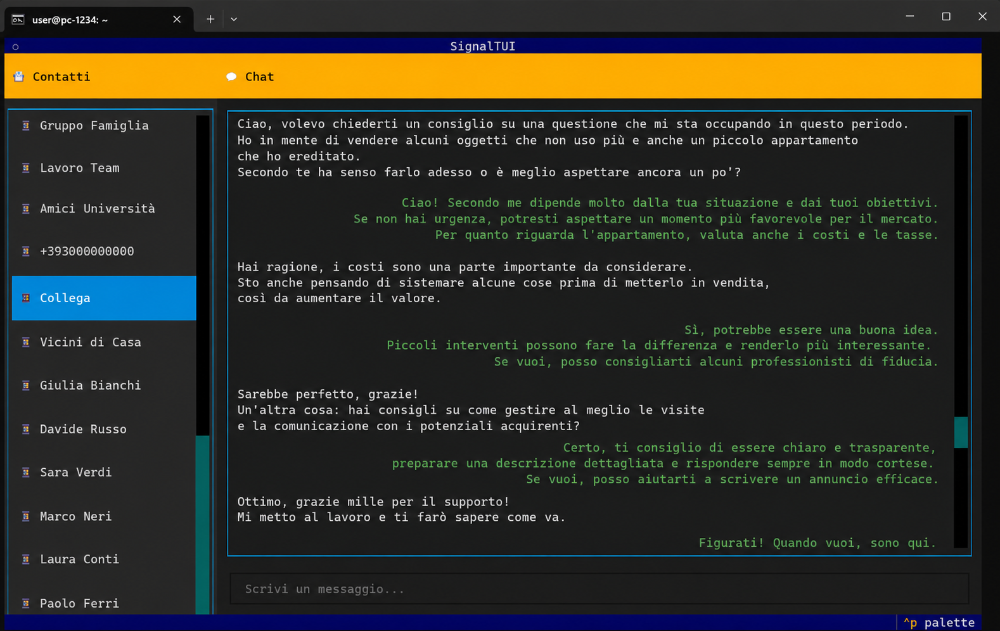
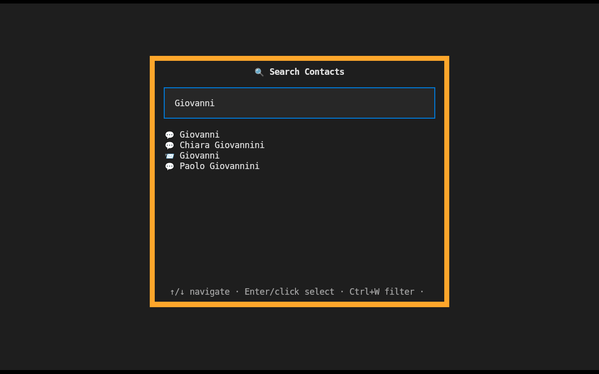
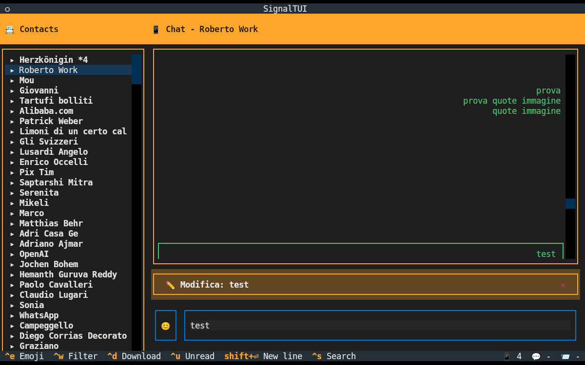
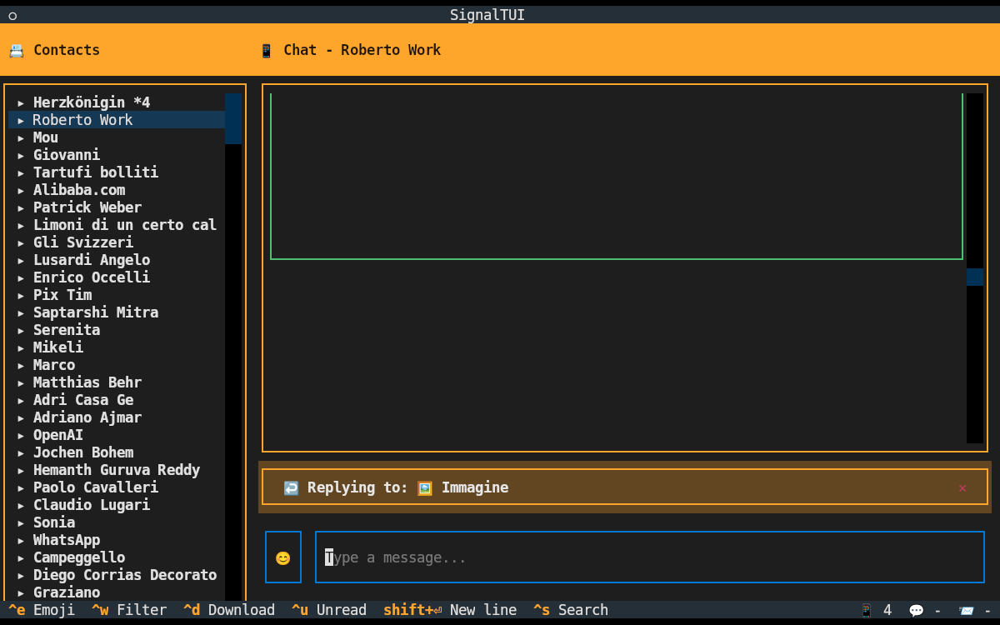
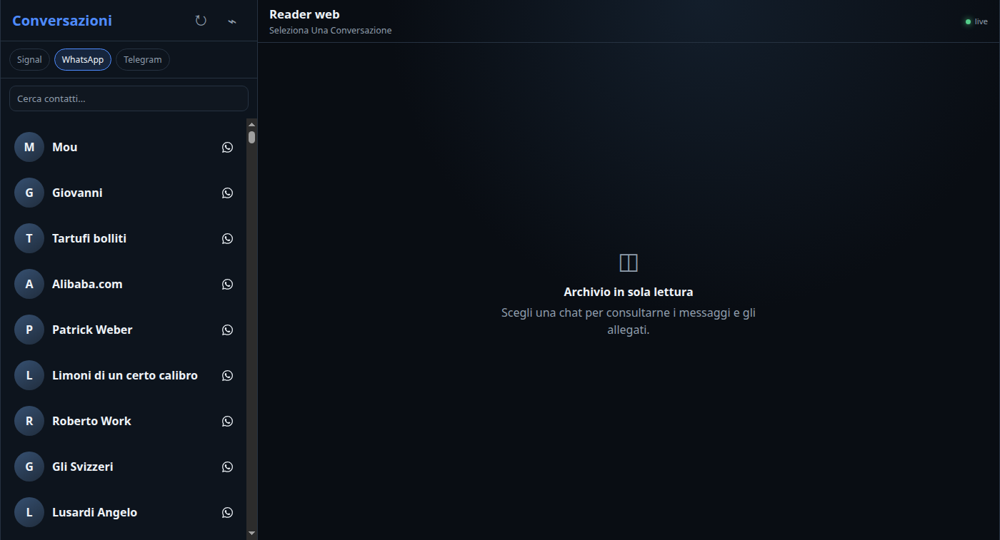
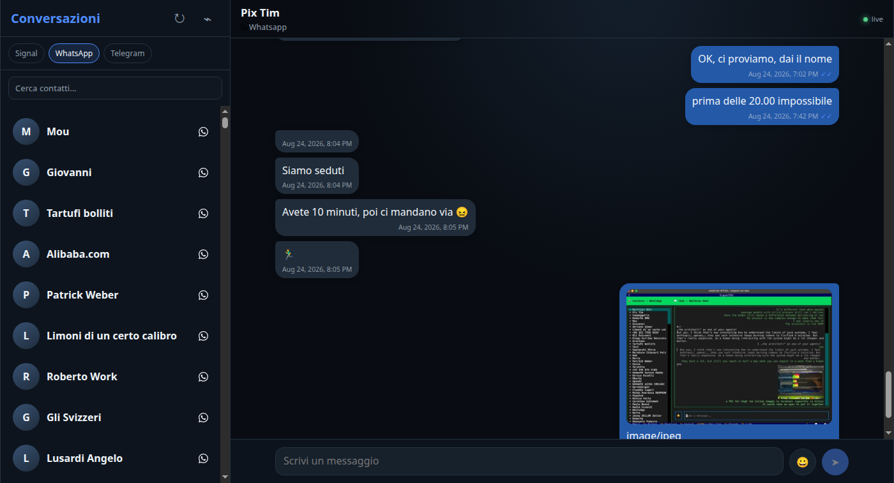
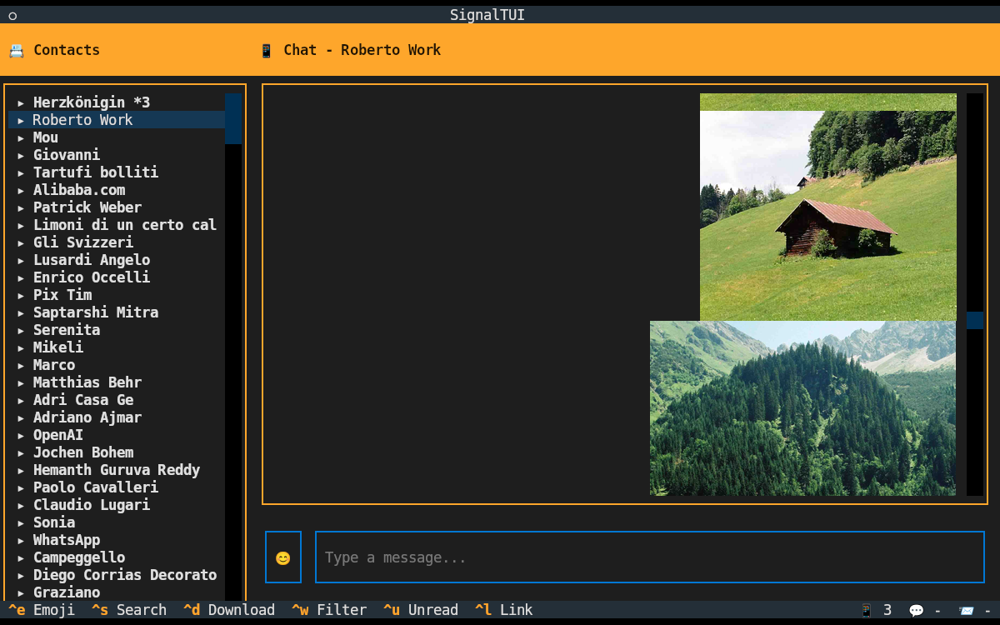

# Signal / WhatsApp / Telegram TUI Client

[](https://codecov.io/gh/Bu3nd14/signal-tui-client)

A terminal-based (TUI) multi-protocol messaging client built with [Textual](https://textual.textualize.io/).

- **Signal**: uses `signal-cli` daemon via JSON-RPC over HTTP for fast operations, with automatic
  fallback to subprocess if the daemon is unavailable.
- **WhatsApp**: optional backend via the lightweight [WAHA](https://waha.devlike.pro/) Docker
  container — incoming messages arrive in real time through webhooks, no polling needed.
- **Telegram**: optional backend using [Telethon](https://docs.telethon.dev/) (MTProto) —
  native Python, no external daemon required. QR login with 2FA support.


*Main chat interface*


*Fullscreen image viewer modal*


*Fullscreen image viewer modal (alternate view)*

## Table of Contents

- [Features](#features)
- [Prerequisites](#prerequisites)
- [Installation](#installation)
  - [Option A — Automatic installation](#option-a--automatic-installation-recommended)
  - [Option B — Manual installation](#option-b--manual-installation)
  - [Enabling the WhatsApp backend (optional)](#enabling-the-whatsapp-backend-optional)
  - [Enabling the Telegram backend (optional)](#enabling-the-telegram-backend-optional)
- [Virtual environment](#virtual-environment-optional-but-recommended)
- [Updating signal-cli](#updating-signal-cli)
- [Device linking](#device-linking)
- [Python launcher (optional alternative to the shell scripts)](#python-launcher-optional-alternative-to-the-shell-scripts)
- [Usage](#usage)
  - [Controls](#controls)
  - [Composing messages](#composing-messages)
  - [Emoji picker](#emoji-picker)
  - [Contact search and address book](#contact-search-and-address-book)
  - [Message editing](#message-editing)
  - [Replies and quoted media](#replies-and-quoted-media)
  - [Message delivery status](#message-delivery-status)
  - [Download mode](#download-mode)
  - [Contact grouping and unread filters](#contact-grouping-and-unread-filters)
- [Native inline images (kitty graphics protocol)](#native-inline-images-kitty-graphics-protocol)
- [Performance profiling](#performance-profiling)
- [Testing](#testing)
- [Project structure](#project-structure)
- [License](#license)

## Features

| Feature | Description | Details |
|---|---|---|
| Unified multi-protocol inbox | Signal, WhatsApp, and Telegram contacts and chats in a single list, with real-time send/receive on all three protocols | [Usage](#usage) |
| **Message editing** *(new)* | Edit your own text messages after sending; incoming edits update the bubble in place | [Message editing](#message-editing) |
| **Emoji reactions in the Web UI** *(new)* | View Signal, WhatsApp, and Telegram reactions, updated live over WebSocket | [Web UI](#web-ui) |
| **Replies with quoted media** *(new)* | Quote an image in a reply (`Alt+R` or Alt+click); incoming media quotes are displayed with caption or typed label | [Replies and quoted media](#replies-and-quoted-media) |
| **Multi-line message input** *(new)* | `Enter` sends, `Shift+Enter` / `Ctrl+Enter` / `Ctrl+J` insert a newline | [Composing messages](#composing-messages) |
| **Full address book search** *(new)* | `Ctrl+S` searches the complete address book of all three backends — including contacts with no existing chat — and can open-or-create the conversation | [Contact search and address book](#contact-search-and-address-book) |
| **Failed-send tracking** *(new)* | Messages that fail to send are marked clearly instead of being silently lost; delivery status transitions are robust to daemon echo races | [Message delivery status](#message-delivery-status) |
| **Instant chat reordering** *(new)* | After an optimistic send the chat list re-sorts by recency immediately, without waiting for the server round trip | [Message delivery status](#message-delivery-status) |
| Native inline images | High-resolution inline thumbnails and fullscreen viewer via the kitty graphics protocol; automatic `catimg` fallback everywhere else | [Native inline images](#native-inline-images-kitty-graphics-protocol) |
| Multiple attachments | A message with several photos shows each one separately (Signal and WhatsApp); clickable placeholders open a fullscreen viewer | [Usage](#usage) |
| Message history | Local SQLite cache, last 200 messages per contact retained; "Load more" fetches older cached messages | [Tips](#tips) |
| Device linking via QR code | Link new devices for Signal, WhatsApp, and Telegram directly from the TUI (`Ctrl+L`) or from helper scripts | [Device linking](#device-linking) |
| Delivery and read receipts | Sent / delivered / read states on outgoing bubbles, plus a distinct failed state; receipts persist across restarts (Telegram) | [Message delivery status](#message-delivery-status) |
| Typing indicators | See when a contact is typing, and briefly after they stop | [Tips](#tips) |
| Emoji picker | Category navigation, search, suggestions, and `:alias:` auto-completion while typing | [Emoji picker](#emoji-picker) |
| Download mode | Serve any message text or attachment via a temporary HTTP URL for easy download | [Download mode](#download-mode) |
| Contacts grouped per person | The same person across backends appears once as an expandable group; flat views when a single backend filter is active | [Contact grouping and unread filters](#contact-grouping-and-unread-filters) |
| Protocol and unread filters | Cycle backend filter (`Ctrl+W`), unread-only view (`Ctrl+U`), full view (`Ctrl+A`), clickable per-backend unread counters in the status bar | [Contact grouping and unread filters](#contact-grouping-and-unread-filters) |

## Prerequisites

| Requirement | Needed for | Notes |
|---|---|---|
| **Python 3.13+** | Everything | |
| **Java 25 (JRE)** | Signal | Required by the `signal-cli` JVM build. Without it, Signal will not start. |
| **signal-cli** (JVM build) in `./bin/` | Signal | Downloaded automatically by `install.sh`; see [Installation](#installation). |
| **requirements-web.txt** | Web UI (optional) | Installed by default by install.sh (skip with --no-web). Never in requirements.txt by design. |
| **Docker + Docker Compose** | WhatsApp | Runs the WAHA container. Skip if you only use Signal. |
| **catimg** | Image rendering | Optional; falls back to text placeholders if missing. On kitty >= 0.20 images render natively, no `catimg` needed — see [Native inline images](#native-inline-images-kitty-graphics-protocol). |
| **A linked account** | Signal and/or WhatsApp and/or Telegram | Via `link_account.py` / `link_whatsapp.py` or the TUI `Ctrl+L` — see [Device linking](#device-linking). |

> **Note:** A Python virtual environment (venv) is **recommended** but not strictly required. See
> [Virtual environment](#virtual-environment-optional-but-recommended).

## Installation

### Option A — Automatic installation (recommended)

The easiest way is to use the provided `install.sh` script, which checks prerequisites, downloads the
correct `signal-cli` build, optionally starts the WAHA Docker container for WhatsApp, creates a
virtual environment and installs the Python dependencies. By default it also creates or updates
`config.json`, enables the local Web UI on `127.0.0.1:4242`, and generates a secure Bearer token
without overwriting existing settings:

```bash
git clone https://github.com/Bu3nd14/signal-tui-client.git
cd signal-tui-client
./install.sh
```

Supported options:

```bash
./install.sh --no-venv            # install without creating a virtual environment
./install.sh --version 0.14.7     # download a specific signal-cli version
./install.sh --skip-signal-cli    # skip downloading signal-cli (if already present)
./install.sh --update             # update signal-cli to the latest version
./install.sh --whatsapp           # start the WAHA Docker container for WhatsApp
./install.sh --check-whatsapp     # check WhatsApp prerequisites (Docker, ports, firewall)
./install.sh --no-web             # skip Web UI dependencies and configuration
./install.sh --aliases            # configure the Web UI and install only its shell aliases
./install.sh --gmail              # configure only the optional Gmail tab (safe after git pull)
./install.sh --help               # show usage
```

### Option B — Manual installation

#### 1. Clone the repository

```bash
git clone https://github.com/Bu3nd14/signal-tui-client.git
cd signal-tui-client
```

#### 2. Install Python dependencies

It is recommended to use a virtual environment (see
[Virtual environment](#virtual-environment-optional-but-recommended)):

```bash
pip install -r requirements.txt
```

#### 3. Download signal-cli

Download the **JVM build** of `signal-cli` (the full `signal-cli-X.Y.Z.tar.gz` archive, **not** the
`-Linux-client` or `-Linux-native` variants):

```bash
# Example for Linux x86_64 — replace X.Y.Z with the actual version (e.g. 0.14.7)
mkdir -p bin
cd bin
wget https://github.com/AsamK/signal-cli/releases/download/vX.Y.Z/signal-cli-X.Y.Z.tar.gz
tar xzf signal-cli-X.Y.Z.tar.gz
rm signal-cli-X.Y.Z.tar.gz
cd ..
```

> **Important — which build to download:**
>
> - **Use:** `signal-cli-X.Y.Z.tar.gz` — the **JVM build** (full archive with `bin/signal-cli` +
>   `lib/*.jar`). This is the **correct** one: it includes the `daemon` command (JSON-RPC over HTTP)
>   that this client uses, and it produces the `./bin/signal-cli-*/bin/signal-cli` structure the app
>   expects.
> - **Do not use:** `signal-cli-X.Y.Z-Linux-client.tar.gz` — only a **JSON-RPC client** (a single
>   native executable). It does **not** include the `daemon` command, so it cannot start the
>   JSON-RPC server this client needs.
> - **Do not use:** `signal-cli-X.Y.Z-Linux-native.tar.gz` — the GraalVM native build. It does not
>   produce the `./bin/signal-cli-*/bin/signal-cli` structure the app expects.
>
> The `releases/latest/download/` URL does **not** work with a versioned filename (the filename
> changes with each release). You must use the explicit `releases/download/vX.Y.Z/` URL and replace
> `X.Y.Z` with the actual version (e.g. `0.14.7`). The `install.sh` script resolves the latest
> version automatically.

The app will automatically find `signal-cli` in the `./bin/signal-cli-*/` directory.

#### 4. Install catimg (optional, for image rendering)

```bash
sudo apt install catimg
```

#### 5. Configure your phone number

Set your Signal phone number via environment variable:

```bash
export SIGNAL_USER_NUMBER="+1234567890"
```

Or create a `config.json` file in the project root:

```json
{
    "user_number": "+1234567890"
}
```

> **Note:** `config.json` is in `.gitignore` and will not be committed.

Next, optionally enable the extra backends:
[WhatsApp](#enabling-the-whatsapp-backend-optional) and/or
[Telegram](#enabling-the-telegram-backend-optional).

### Enabling the WhatsApp backend (optional)

WhatsApp is an **optional** backend that talks to a lightweight WhatsApp HTTP API.
The recommended way is to run the official **WAHA** (`devlikeapro/waha`) container
via Docker Compose — **no Node.js to install, no manual service to run**. If it
is not configured/started, the client runs exactly as before (Signal only) and
gracefully skips WhatsApp.

#### One-command startup (Docker)

```bash
docker compose up -d            # start WAHA (WhatsApp HTTP API) on http://127.0.0.1:3005 — no CPU/RAM caps
./scripts/start_whatsapp.sh     # (optional) start + wait until the API is ready — CPU/RAM caps applied by default
```

or use the installer:

```bash
./install.sh --whatsapp
```

`./scripts/start_whatsapp.sh` and `./install.sh --whatsapp` both apply the WAHA container's CPU/RAM
caps (1.5 CPU / 4GB RAM) by default; pass `--no-docker-limits` to either to skip them. A bare
`docker compose up -d` never applies the caps (see [below](#running-without-cpuram-caps---no-docker-limits)).

The installer creates `.env` with secure WAHA credentials and `0600` permissions,
preserving any existing WAHA or Telegram values. The API then listens on
`127.0.0.1:3005` by default (override with `WHATSAPP_API_PORT`); session + media
persist in `./whatsapp-data/` (git-ignored).
On ARM hosts such as Apple Silicon, the installer selects WAHA's native `:arm`
image; x86_64 hosts continue to use `:latest`.
If Docker isn't installed, the configuration below still lets you point the
backend at any compatible Baileys API.

> **API key (authentication):** REST calls without the correct key return `401`.
> `./install.sh --whatsapp` generates and persists the credentials automatically.
> For a manual Docker Compose setup, copy the defaults and fill in secure values:
>
> ```bash
> cp .env.example .env       # then edit `.env` and set WAHA_API_KEY etc.
> docker compose up -d       # (re)start WAHA so it picks up the key
> ```
>
> `docker-compose.yml` loads `.env` via `env_file`, so WAHA reuses the key across
> restarts instead of regenerating it. The Python client reads the same
> `WAHA_API_KEY` from `.env` automatically; it can also be set explicitly with
> `WHATSAPP_API_KEY` (see below). To grab the current values from a running
> container: `docker exec signal-tui-whatsapp env | grep WAHA_API_KEY`.

#### Running without CPU/RAM caps (`--no-docker-limits`)

`./install.sh --whatsapp`, `./scripts/start_whatsapp.sh`, `./scripts/restart_backend.sh`,
`./scripts/start_on_server.sh start`, and `./scripts/tui_handover.sh {to-server,to-local}` all layer
`docker-compose.resources.yml` on top of `docker-compose.yml` **by default**, capping the WAHA
container at 1.5 CPU / 4GB RAM. Pass `--no-docker-limits` to any of them to skip that, or set
`WAHA_DOCKER_LIMITS=0` in `.env` to skip it on every command (handover included):

```bash
./scripts/start_whatsapp.sh --no-docker-limits
./install.sh --whatsapp --no-docker-limits
```

> **Running inside an unprivileged Proxmox/LXC container:** those CPU/RAM caps need the memory
> cgroup controller delegated to the Docker host. Without it, `docker compose up` fails with
> `error setting cgroup config for procHooks process: ... memory.max: no such file or directory`.
> Either fix delegation on the Proxmox **host** with `pct set <vmid> --features nesting=1,keyctl=1`
> (then reboot the CT), or pass `--no-docker-limits` to skip the caps entirely. A bare
> `docker compose up -d` (no script/launcher involved) never applies the caps in the first place —
> to apply them yourself, layer the file manually:
> ```bash
> docker compose -f docker-compose.yml -f docker-compose.resources.yml up -d
> ```

#### Extra compose files (`WAHA_COMPOSE_FILES`, `--compose-file`)

The launcher can layer your own compose files on top of WAHA's (port mappings, volumes, other
limits, extra services, ...). They come after `docker-compose.yml` and the resources overlay, so
their values win:

```bash
# Permanent: in .env (or the environment), separated by ":"; relative to the project directory
WAHA_COMPOSE_FILES=docker-compose.local.yml:/etc/megachat/waha.yml

# One run only: repeatable, relative to the current directory, added after WAHA_COMPOSE_FILES
python3 launcher.py whatsapp start --compose-file my-limits.yml
python3 launcher.py server start --compose-file my-limits.yml --compose-file ports.yml
```

`--compose-file` is accepted by `install`, `whatsapp start`, `backend-restart`, `server start` and
`handover to-local`; `whatsapp stop`, `server stop` and the handover also pass the
`WAHA_COMPOSE_FILES` files to `docker compose down` (put files you always use there, not on the
command line). The remote side of a handover reads its own `.env`.

Example — different caps instead of the default ones (the later file overrides the values it sets):

```yaml
# docker-compose.local.yml
services:
  whatsapp:
    deploy:
      resources:
        limits:
          cpus: '2'
          memory: 2048M
```

To drop the caps entirely you don't need a replacement file: set `WAHA_DOCKER_LIMITS=0`. Don't give
a file that `include:`s `docker-compose.yml` — the launcher always passes the base file itself.

#### Configuration (env or `config.json`)

Environment variables:

```bash
export WHATSAPP_API_PORT="3005"                       # docker-compose host port (default 3005)
export WHATSAPP_API_URL="http://127.0.0.1:3005"      # base URL of the WAHA API
export WHATSAPP_API_KEY="<api-key>"                  # X-Api-Key (auto-read from .env if unset)
export WHATSAPP_SESSION_NAME="default"               # session name (default "default")
export WHATSAPP_MEDIA_DIR="/srv/whatsapp-media"      # local media download dir
```

…or via `config.json`:

```json
{
    "user_number": "+1234567890",
    "whatsapp_api_url": "http://127.0.0.1:3005",
    "whatsapp_api_key": "<api-key>",
    "whatsapp_session_name": "default",
    "whatsapp_media_dir": "/srv/whatsapp-media"
}
```

#### Pair the device

With the API running, link the device with:

```bash
source .venv/bin/activate        # use the project venv (has qrcode + deps)
python3 link_whatsapp.py         # prints a QR to scan with WhatsApp
```

> Tip: `link_whatsapp.py` **auto-restarts** inside `.venv/bin/python` if you run
> it with the system python, so `python3 link_whatsapp.py` works either way.
>
> **Alternatively**, link directly from the TUI: launch the app and press `Ctrl+L`,
> select WhatsApp, and scan the QR code. The TUI handles the entire flow including
> waiting for server-side contacts sync with a progress indicator. See
> [Device linking](#device-linking).

### Enabling the Telegram backend (optional)

The Telegram backend uses [Telethon](https://docs.telethon.dev/) and requires
**no external daemon** — everything runs in-process.

#### Get API credentials

1. Go to [my.telegram.org](https://my.telegram.org) and log in with your phone number
2. Click **API Development Tools**
3. Fill in **App title** and **Short name** (any values are fine, no URL needed)
4. Click **Create application**
5. Copy your **`api_id`** (integer) and **`api_hash`** (string)

> Your `api_hash` is **secret** — never commit it or share it publicly.

#### Configure credentials

Add to the project `.env` file (`cp .env.example .env` if not already present):

```bash
TELEGRAM_API_ID=123456
TELEGRAM_API_HASH=your_hash_here
```

#### Pair the device (QR login)

With credentials configured, launch the TUI:

```bash
source .venv/bin/activate
python3 signal_tui.py
```

Press `Ctrl+L`, select **Telegram**, and scan the QR code with your phone.

> If your Telegram account has **2FA** enabled, the TUI will show a password
> field after scanning the QR. Enter your 2FA password and press Enter.
>
> If you don't have 2FA, the login completes automatically.

## Python launcher (optional alternative to the shell scripts)

`launcher.py` is a stdlib-only Python reimplementation of every operational shell script in this
repo (`install.sh`, `scripts/*.sh`, `profiling/run_*.sh`, `tests/run_regression_tests.sh`). It's an
**optional alternative** — the original scripts remain the primary, documented way to do each of
these things and are not going away; use whichever you're more comfortable with. `launcher.py`
mainly helps on platforms where bash isn't the default shell (e.g. Windows without WSL), or if you
just prefer not to shell out.

| Task | Shell script | `launcher.py` equivalent |
|---|---|---|
| Full install | `./install.sh [options]` | `python3 launcher.py install [options]` |
| Shell aliases only | `./install.sh --aliases` | `python3 launcher.py aliases` |
| Start/stop WAHA | `./scripts/start_whatsapp.sh [--no-wait\|--stop]` | `python3 launcher.py whatsapp start\|stop [--no-wait]` |
| Restart signal-cli + WAHA | `./scripts/restart_backend.sh [--no-wait]` | `python3 launcher.py backend-restart [--no-wait]` |
| Run the headless server on this machine (also disaster recovery on the remote one) | `./scripts/start_on_server.sh {start\|stop\|status}` | `python3 launcher.py server start\|stop\|status` (see [Headless server](#headless-server-megachat-serve)) |
| Local ↔ remote handover (moves `megachat serve`) | `./scripts/tui_handover.sh {to-server\|to-local\|status}` | `python3 launcher.py handover to-server\|to-local\|status` |
| CPU/I-O profiling | `./profiling/run_pyspy.sh` / `run_strace.sh` `[duration]` | `python3 launcher.py profile pyspy\|strace [duration]` |
| Regression tests | `./tests/run_regression_tests.sh` | `python3 launcher.py test` |

The handover and `start_on_server.sh` start and stop the detached headless server (`megachat serve`,
web on `0.0.0.0:4242`, Unix socket enabled), not a TUI inside tmux. Stopping is SIGINT to the lock pid,
waiting for it to exit (a legacy tmux `tui` session is still killed, never started); if the server does
not stop, the command aborts instead of risking two servers. To work interactively on the target
machine run `python3 megachat.py` there: it attaches to the running server (Detach leaves it running,
Quit stops it). See [`docs/HANDOVER.md`](docs/HANDOVER.md).

Same flags, same behavior (the alias block it writes is byte-for-byte identical to `install.sh`'s),
same exit codes — pick whichever entry point fits your environment. `python3 launcher.py --help`
lists every command; each subcommand also takes `--help`.

## Virtual environment (optional but recommended)

A Python virtual environment is **recommended** to avoid polluting your system Python and to prevent
dependency conflicts. It is **not strictly required** — the app is a standalone script launched with
`python3 signal_tui.py`.

> **Note:** On many Linux distributions, `pip install` at the system level is blocked (PEP 668 /
> "externally-managed-environment"). In that case a virtual environment is **required**.

```bash
# Create the virtual environment
python3 -m venv .venv

# Activate it
source .venv/bin/activate

# Install dependencies
pip install -r requirements.txt
```

To deactivate the environment later, run `deactivate`. The `install.sh` script creates and uses the
virtual environment automatically (unless you pass `--no-venv`).

## Updating signal-cli

Signal's servers change over time, and `signal-cli` releases older than ~3 months may stop working.
To update `signal-cli` to the latest version, run:

```bash
./install.sh --update
```

This downloads the latest JVM build, extracts it into `./bin/`, and removes the previous version(s).

## Device linking

Before using the client, you need to link your accounts. You can do this either from the command
line or directly from the TUI.

### From the command line

```bash
python3 link_account.py          # Signal
python3 link_whatsapp.py         # WhatsApp
```

Each script displays a QR code. Scan it with the respective app on your phone. There is no CLI
script for Telegram — pair it from the TUI as described below.

### From the TUI

Launch the app and press `Ctrl+L`, select Signal, WhatsApp, or Telegram, then scan the QR code. For
Signal you may need to enter your phone number. For Telegram with 2FA, the TUI will prompt for your
password after scanning.

## Usage

```bash
python3 megachat.py                  # the TUI: attach to a running server, or start one (see below)
python3 signal_tui.py                # same thing
python3 megachat.py --connect PATH   # attach to the server on this Unix socket; never start one
python3 megachat.py --in-process     # debugging/tests: the chat core runs inside the TUI (no server)
python3 megachat.py serve            # the headless server only (web UI, no TUI)
```

The TUI is a client of the chat server. At startup it looks for a server on the Unix socket
(`$MEGACHAT_SOCKET`, else `$XDG_RUNTIME_DIR/megachat/server.sock`, else
`~/.local/state/megachat/server.sock`); if one answers it attaches, otherwise it starts
`megachat serve` detached (same Python and checkout, no TUI, `--no-web` unless you pass `--web...`
flags or `config.json` enables the web UI), waits for its socket (up to 30 s) and attaches. Ctrl+C only
disconnects the TUI (the server keeps running); Ctrl+Q asks what to do, see
[Leaving the TUI](#leaving-the-tui). Any number of TUIs can attach to the same server. Web options (`--web`, `--web-port`, ...) are forwarded to a server the TUI
starts; they are ignored, with a note, when it attaches to one already running. A spawned server's
output goes to `/tmp/megachat-serve.log`, the server's own log to `/tmp/signal-tui.log` and the
TUI's to `/tmp/megachat-tui.log`.

The app starts the `signal-cli` daemon automatically on first launch (for Signal) and a webhook
HTTP server for WhatsApp push events. See the subsections below for details on each area.

### Leaving the TUI

`Ctrl+Q` opens a dialog (keys: `d`, `q`, `Esc`, arrows/`Tab`, `Enter`):

| Choice | Effect |
|--------|--------|
| **Detach** (`d`) | Closes this TUI; the server keeps running (web UI, other TUIs, background sync) |
| **Quit** (`q`) | Stops the server cleanly (as `Ctrl+C` does on `megachat serve`: prune, disconnect), then exits |
| **Annulla** (`Esc`) | Back to the chat |

The default button is Quit when this TUI started the server and Detach when it attached to one
that was already running. If other clients are connected the dialog says so ("Altri N client
connessi") and Quit asks for a second confirmation. `Ctrl+C` (SIGINT) never opens the dialog and
never stops a server: it always detaches. If the server cannot be reached, `Ctrl+Q` just exits.
`megachat --in-process` has no dialog (it owns the core and quits as before).

<a id="tips"></a>

### Controls

| Key | Action |
|-----|--------|
| `↑` / `↓` | Navigate contact list |
| `Enter` | Select contact / open chat |
| `Enter` (on image) | Open image in fullscreen modal |
| `Escape` / `q` (in modal) | Close image modal |
| Type message + `Enter` | Send message (with quote if replying) |
| `Shift+Enter` / `Ctrl+Enter` / `Ctrl+J` | Insert a newline in the message input |
| `Click` / `Enter` (on message) | Select message to reply to |
| Close button (reply bar) | Cancel reply selection |
| `Alt+E` (or Alt+click, on your own text message) | Start editing that message — see [Message editing](#message-editing) |
| `Alt+R` (or Alt+click, on an image) | Quote that media in a reply — see [Replies and quoted media](#replies-and-quoted-media) |
| `Ctrl+E` | Open emoji picker |
| `Ctrl+S` | Open contact search over the full address book of all backends |
| `Ctrl+D` | Toggle download mode |
| `Ctrl+W` | Cycle contact filter: all → Signal → WhatsApp → Telegram (single-backend views are flat) |
| `Ctrl+U` | Toggle the "unread only" filter (combines with the `Ctrl+W` backend filter) |
| `Ctrl+A` | Return to the full **All** view (backend filter + unread filter off) |
| `Click` / `Enter` / `space` (on group header) | Expand / collapse a contact group (in the All view) |
| `Click` / `Enter` (on a row in a filtered view) | Open the chat directly |
| Click (on a status-bar segment) | Jump to that backend — unread view if it has unread, else its plain filter |
| `Ctrl+L` | Link a new device (Signal / WhatsApp / Telegram) via QR code |
| `Ctrl+N` / `Ctrl+P` | Navigate emoji suggestions / emoji picker categories |
| `Ctrl+Q` | Exit: **Detach** / **Quit** / Cancel dialog — see [Leaving the TUI](#leaving-the-tui) |
| `Ctrl+C` | Detach (disconnect this TUI; the server keeps running) |

### Composing messages

The message input is a small multi-line editor:

- **`Enter`** sends the message.
- **`Shift+Enter`**, **`Ctrl+Enter`**, or **`Ctrl+J`** insert a newline, so you can write multi-line
  messages before sending.
- Pasted text with Windows/Mac line endings is normalized to `\n`.
- While typing, `:alias:` shortcuts are auto-completed (see [Emoji picker](#emoji-picker)).

### Emoji picker

Press **`Ctrl+E`** to open the emoji picker. Inside the picker:

- **`Tab`** / **`Shift+Tab`** — move focus between: category tabs → emoji grid → search bar
- **`Ctrl+F`** — jump to the search bar
- **`Ctrl+N`** / **`Ctrl+P`** — switch between emoji categories
- **`←`** / **`→`** / **`↑`** / **`↓`** — navigate the emoji grid
- **`Enter`** — insert the selected emoji at the cursor position
- **`Escape`** — close the picker without inserting

You can also type `:alias:` shortcuts directly in the message input — for example, typing
`:smile:` inserts a smiley face and `:heart:` inserts a heart symbol. A completion popup appears as
you type; use `Ctrl+N`/`Ctrl+P` to navigate and `Enter` to confirm.

### Contact search and address book

Press **`Ctrl+S`** to open the contact picker. Since the address-book update it searches the
**complete address book of all three backends** — not just contacts with an existing chat:

- **Type** — the result list updates live as you type, filtering by name or number (case-insensitive)
- **Tab** — move focus from the search input to the results list (`Shift+Tab` to go back)
- **↑** / **↓** — navigate the matching entries
- **Enter** / **click** — select the highlighted entry and close the picker
- **Escape** — close the picker without selecting
- **`Ctrl+W`** (inside the picker) — cycle the protocol filter: all → Signal → WhatsApp → Telegram

Behavior details:

- Contacts from the three backends are aggregated and sorted by recency, then alphabetically.
  The same person present on multiple protocols is shown as a single entry; selecting it opens a
  small sub-dialog to choose the backend (the most recent one is pre-selected; `Escape` returns to
  the picker).
- Selecting a contact **without an existing chat** opens-or-creates the conversation on that
  backend. Newly opened WhatsApp numbers get a best-effort existence check.
- The address book is loaded asynchronously; a loading indicator is shown while fetching.
- The selected contact's chat opens and is highlighted in the contact list, exactly as if you had
  selected it manually.

Implementation: `contact_picker.py`; design notes in `docs/DESIGN_CTRLS_RUBRICA.md`.



### Message editing

Your own **text** messages can be edited after sending, on all three protocols (Signal, Telegram,
WhatsApp):

- Press **`Alt+E`** (or **Alt+click**) on one of your own text messages: the text is loaded into the
  message input and the bubble is highlighted. Replying and editing are mutually exclusive —
  starting one cancels the other.
- **`Enter`** submits the edit **optimistically**: the bubble, in-memory cache, and database are
  updated immediately, then the network call runs in a worker thread. On failure or rejection the
  original text is restored automatically.
- The edited bubble keeps its original timestamp and gains a persistent `(modificato)` marker.
- **Incoming edits** from other people update the existing bubble **in place** — no duplicated
  messages, no unread bump. Edits you make from another linked device are applied to this session
  idempotently.

Limitations: only text messages can be edited (not media or captions); messages still *pending* or
*failed* cannot be edited; there is no edit history — the latest text wins.

Implementation: `tui/edit.py`; design notes in `docs/DESIGN_EDIT_MESSAGES.md`.



### Replies and quoted media

- **Reply to a text message**: click it (or focus and press `Enter`) — the reply bar shows what you
  are quoting; the close button cancels.
- **Quote an image in a reply**: press **`Alt+R`** or **Alt+click** on an image. A plain click /
  `Enter` still opens the fullscreen viewer, unchanged.
- **Incoming media quotes are visible**: when someone replies quoting a photo/video/audio/file, the
  quoted bubble shows the real caption when present, otherwise a typed media label.
- **Outgoing media quotes reach recipients correctly**: on Signal the quoted thumbnail travels with
  the message (`quoteAttachments`), so the recipient sees the quoted image; WhatsApp and Telegram
  use their native reply IDs.

Retrying a failed media reply preserves the correct quote even after a restart.

Implementation: `ui_components.py` (`alt+r` binding on `ImageWidget`), `tui/send.py`;
design notes in `docs/DESIGN_QUOTE_MEDIA_37_V2.md` and `docs/DESIGN_QUOTE_MEDIA_37_PLANB.md`.



### Message delivery status

Outgoing messages show their delivery status directly on the bubble:

| Status | Style | Meaning |
|---|---|---|
| *pending* | dim/muted color | Being sent (optimistic phase) |
| *sent* | italic | Accepted by the server, not yet delivered |
| *delivered* | bold | Reached the recipient's device |
| read | normal | Seen by the recipient |
| ***failed*** | bold, red | Send rejected or errored — the message was not delivered |

Notes:

- The *pending → sent* transition is robust against timestamp differences in the daemon's echo of
  your own message (no stuck grey bubble).
- Failed sends remain marked as such so nothing is silently lost.
- Right after you send a message, the contact list **re-sorts immediately by recency** — the chat
  you just wrote to jumps to the top without waiting for the server round trip.
- Read receipts work on all three protocols: WhatsApp runtime receipts are reflected live, and
  Telegram read state persists across restarts.

### Download mode

Press **`Ctrl+D`** to enter download mode, then click any message to serve it for download:

- **Text messages** are served as `.txt` files
- **Images and attachments** are served with their original filename and extension

A persistent HTTP server starts on port **10042** (first download only) and stays alive for the
duration of the app. The download URL is shown in a selectable `Input` widget — use **Tab** to focus
it, then **Cmd+C / Ctrl+C** to copy the URL and paste it into your browser.

> **Note:** You need to open port **10042** on your server's firewall for downloads to work.

> **macOS users:** Terminal.app does not allow copying text from Textual widgets with `Cmd+C`. For
> the best experience, use **[iTerm2](https://iterm2.com/)** (free), which supports clipboard access
> from terminal applications.

### Contact grouping and unread filters

The contact list groups the same person across backends: one **header** row shows the person's best
name plus an aggregate unread badge (in the "All" view), and one **member** row per protocol sits
below it, labeled with that protocol's icon and color.

- Groups are **collapsed by default**: you see one row per person. `Click`/`Enter`/`space` on the
  header expands or collapses the group; `Click`/`Enter` on a **member** row opens that backend's
  chat.
- In **"All"** view the header badge is the aggregate unread count of the person's members.
- With a **single-backend filter** (`Ctrl+W`) the list becomes **flat**: one row per person (no
  chevron), clicking a row opens the chat directly, and the badge shows only the unread of that
  filtered view. Rows are sorted by per-backend recency and the first contact is auto-selected when
  you change filter. The backend border color is kept even when the unread filter is on.
- **`Ctrl+U`** toggles the **unread-only** filter: only contacts/groups with at least one unread
  message are shown. It composes with `Ctrl+W` (e.g. `Ctrl+W` → WhatsApp, then `Ctrl+U` → only your
  unread WhatsApp messages). The currently selected contact stays pinned in view.
- **`Ctrl+A`** returns to the full All view (both filters off).
- The **status bar** always shows the per-backend unread totals as three clickable segments (one per
  protocol, `-` when zero). Clicking a segment jumps to that backend: to its **unread view** if it
  has unread messages, otherwise to its **plain filter**. When the bar shows a transient message or
  an error the segments are hidden and reappear (updated) once the message clears.

> Note: `Ctrl+U` and `Ctrl+A` take over two text-editing shortcuts in the message input
> ("delete to line start", "cursor to line start"); use `super+backspace` / `home` instead.
> While the contact picker (`Ctrl+S`) is open these shortcuts are disabled.

### Tips

- Messages are persisted locally in a SQLite database
  (`~/.local/share/signal-tui-client/messages.db`) with up to 200 messages retained per contact
- The last 20 messages are shown when opening a chat; click "Load more" to see older cached messages
- Unread messages are shown with a `*N` badge: aggregate on the group header in the "All" view,
  filtered to the current backend in filtered views
- A writing-hand icon next to a contact name means they are typing; a thought-bubble icon appears
  briefly after they send a message or stop typing
- Use `Ctrl+U` to focus on unread conversations, `Ctrl+A` to go back to All — see
  [Contact grouping and unread filters](#contact-grouping-and-unread-filters)

## Web reader aliases

Three shell aliases (bash/zsh/ash) launch the optional web reader and manage its lifecycle:

The automatic installer enables the Web UI in `config.json`, so a normal
`python3 signal_tui.py` start also serves it locally on `http://127.0.0.1:4242`.

| Alias | What it does |
|---|---|
| `web-signal-tui` | Starts the TUI with the web server on `0.0.0.0:4242`: attaches to a running server or starts one that keeps running after the TUI exits (stop it with `web-signal-tui-stop`) |
| `web-signal-tui-bg` | Starts the headless server (`launcher.py server start`: WAHA + `megachat serve`, no TUI) as a **detached background process** and **exports** the Bearer token to your shell as `SIGNAL_TUI_WEB_TOKEN`; extra arguments go to `server start` (e.g. `web-signal-tui-bg --web-port 8080`) |
| `web-signal-tui-stop` | Cleanly stops the background server, leaving WAHA running (`launcher.py server stop --keep-whatsapp`) |

`signal-tui-bg` and `signal-tui-stop` are shorter aliases for the two background commands.
Starting the background command is idempotent: when the server is already running it still prints
and exports the current token instead of failing.

> The web server requires the optional dependencies in requirements-web.txt (installed by default; if you used --no-web: .venv/bin/pip install -r requirements-web.txt). Without them the TUI logs "optional dependencies are missing (web down)" and continues normally.

### Headless server (`megachat serve`)

The web UI no longer needs the TUI (or tmux) to stay alive. `megachat serve` runs the chat core and
the web adapter without Textual, logs to `/tmp/signal-tui.log`, prints the web URL and Bearer token,
and runs until SIGINT/SIGTERM (then stops the core and the web server, prunes the message cache and
releases the lock).

Start, stop and inspect it through the launcher — one command for every way of running it:

```bash
python3 launcher.py server start                         # WAHA + server, detached, web on 0.0.0.0:4242
python3 launcher.py server start --web-host 127.0.0.1 --web-port 8080
python3 launcher.py server start --web-host 127.0.0.1,192.168.1.10   # several interfaces
python3 launcher.py server start --web-no-auth           # no token (trusted networks only, warns)
python3 launcher.py server start --foreground            # in this terminal; Ctrl+C stops it
python3 launcher.py server start --no-whatsapp --no-web  # no WAHA, no web UI (socket only)
python3 launcher.py server status                        # server, signal-cli, WAHA, web UI address
python3 launcher.py server stop                          # server + WAHA
python3 launcher.py server stop --keep-whatsapp          # server only
```

`server start` options: `--web-host` (default `0.0.0.0`; comma-separate addresses to listen on
several interfaces, or set `web.host` in `config.json` to a list such as
`["127.0.0.1", "192.168.1.10"]`), `--web-port` (default `4242`),
`--web-no-auth`, `--no-web`, `--socket PATH` / `--no-socket`, `--debug`, `--no-whatsapp`,
`--foreground`, `--no-token` (don't print the token), `--no-docker-limits`. The `--web-*`,
`--socket`, `--no-socket`, `--no-web` and `--debug` options are passed to `megachat serve`; a
detached server's stdout/stderr go to `/tmp/megachat-serve.log`, and its options are recorded next
to the lock (`/tmp/signal-tui.lock.json`) so `server status` reports the real address. `start`
restarts a server that is already running. `python3 megachat.py serve [same --web-* options]` still
works for running the bare server by hand.

The server holds the single-instance lock (`/tmp/signal-tui.lock`, override with
`$MEGACHAT_LOCK_FILE`); attached TUIs never take it, only `megachat --in-process` does (so it
cannot run next to a server). `megachat.py` with any other arguments starts the TUI as before
(`python3 signal_tui.py` keeps working). Stopping the server disconnects every attached TUI; they
show a reconnect message and resync if a new server appears.

### Fast cycle (background + token)

`web-signal-tui-bg` runs in the background and exports `SIGNAL_TUI_WEB_TOKEN` to the current shell,
so the token is immediately ready for the Web UI login (it is printed to the console) or for `curl`:

```bash
web-signal-tui-bg
# Server bg attivo — token: <the-token>

curl -H "Authorization: Bearer $SIGNAL_TUI_WEB_TOKEN" http://127.0.0.1:4242/api/contacts
```

The Bearer token lives in `config.json` under `web.token`; the web server also accepts it via the
`SIGNAL_TUI_WEB_TOKEN` environment variable. The default port is `4242`.

### Running without a token (`--web-no-auth`)

For a trusted local/LAN setup where you don't want to deal with the Bearer token at all, start the
web server with `--web-no-auth`:

```bash
python3 signal_tui.py --web --web-no-auth
```

This drops authentication entirely on every REST, media, and WebSocket endpoint — **anyone who can
reach `--web-host`/`--web-port` gets full read/send access with no credential**. The browser also
skips the login dialog automatically. Only use this on a network you trust (e.g. `127.0.0.1` only,
or a LAN behind your own firewall); never combine it with `--web-host 0.0.0.0` on a machine exposed
to the internet.

### Web UI

The optional web reader gives read-only access to conversations and attachments from a browser:
Emoji reactions from Signal, WhatsApp, and Telegram are shown on message bubbles and update live over
WebSocket. Legacy empty reaction bubbles can be removed with `migrate_reactions_cleanup.py` (dry-run by
default; pass `--apply` to apply the cleanup).





### Gmail (optional)

The Gmail tab is configured from a terminal, so the App Password never passes through the browser:

```bash
./install.sh --gmail
# or, on an existing/forked checkout after `git pull`:
python3 scripts/gmail_setup.py
```

The script asks for the Gmail address and a Google **App Password** (hidden input), verifies IMAP and
SMTP login, stores the secret in `~/.config/signal-tui/gmail-app-password` with `600` permissions and
updates `.env`. Then reload the Gmail tab in the Web UI. Email HTML is sanitized server-side:
scripts, `<style>` blocks, classes, iframes and external CSS are removed, while safe inline CSS
(allow-listed properties/values; no `url()`, `position`, `var()` or `calc()`) and legacy table
attributes are preserved, within size/complexity caps. The reader can toggle between HTML and plain
text. Remote images are loaded by default through the same-origin `/gmail-image` proxy, so the
sender never sees the browser's IP: it sees the server's IP, at the time the message is opened.
Tracking is therefore accepted. When a message is opened the server starts fetching its first 30
remote images in the background and keeps them in memory (48 MB, 15 minutes), so the browser's
requests find them ready; responses are sent with `Cache-Control: private, max-age=3600`, so
reopening a message within the hour does not re-ping the tracker. Set `GMAIL_IMAGE_PREFETCH=0` to
disable the prefetch. Images are capped at **50 per message**, **25 MP each**, and the
proxy allows at most **4 concurrent Gmail image fetches**. Residual risks: the signed image URL
does not expire and is not single-use, `/gmail-image` is mounted outside the Bearer-protected
`/api` namespace, and there is no per-message aggregate budget: the theoretical ceiling is
50 × 25 MP ≈ 1.25 Gpixel (~5 GB decoded RGBA) and 50 × 8 MiB = 400 MB of payload, while the
semaphore only bounds concurrency (4 per worker; the background prefetch adds up to 4 more). `<style>` blocks are inlined server-side with
`css-inline` (only allow-listed properties, no `@media`/remote CSS) before sanitization; set
`GMAIL_HTML_INLINE_CSS=0` to disable it. Responsive (`@media`) layouts are not reproduced.
Inline `cid:` images (signatures, logos) are served by the same proxy with a signed token that
expires after 24 hours, only when the MIME part's bytes are a raster image.

Like the chat backends, Gmail shows a red dot on its tab when there is unread mail (hidden while
the Gmail view is open), and its unread count is added to the Dock/app badge total. The count
covers only the **200 newest messages the list shows**, so years of old unread mail do not keep
the badge in the thousands. Gmail has no push channel, so the server checks the inbox every
`GMAIL_UNREAD_POLL_S` seconds (default 60, `0` disables it) with a read-only `SELECT` and one
`SEARCH UNSEEN` on that window, and pushes the count to the web client over the WebSocket;
opening or deleting a message re-checks at once, and new mail refreshes the open Gmail list.
IMAP IDLE would be instant but needs a dedicated, always-open connection.

The reader's action bar uses icons (with tooltips): reply, reply all, forward, archive, delete,
and a "more" menu with *Segna come non letto* and the HTML/text view switch. Reply all addresses
the sender and the original recipients (Cc kept), never your own address. Forward adds the
original header block and text and **attaches the original files** (not the inline images),
within the usual 10-file / 25 MB limits. Archive removes Gmail's Inbox label (`X-GM-LABELS`), so
the message stays in All Mail; it is offered only in the inbox.

> After pulling a version that adds the HTML reader, install the new web dependencies once:
> `.venv/bin/pip install -r requirements-web.txt` (or re-run `./install.sh`). `./install.sh --gmail`
> installs `nh3`, `tinycss2` and `css-inline` automatically if they are missing.

Optional at-rest encryption: `bash scripts/gmail_gpg_init.sh` (GPG passphrase; it also configures
the gpg-agent cache, 7 days by default via `--cache-ttl`) or `bash scripts/gmail_tpm_init.sh`
(Linux TPM2 only — macOS has no TPM2/systemd; requires the `tss` group and a re-login). See
[docs/DESIGN_GMAIL_POC.md](docs/DESIGN_GMAIL_POC.md) and [.env.example](.env.example).

### Installing the aliases

Automatic install — detects bash/zsh/ash and writes the real project path:

```bash
./install.sh --aliases
```

Or manually copy the alias block from [docs/ALIASES.md](docs/ALIASES.md) into `~/.bashrc` (bash),
`~/.zshrc` (zsh), or `~/.ashrc` (ash — make sure `$ENV` points there), then reload the file (or
reopen the shell).

> **Compatibility:** bash, zsh, and ash are supported; other shells (fish, dash/sh) are not — see
> [docs/ALIASES.md](docs/ALIASES.md).

## Native inline images (kitty graphics protocol)

In chats with images the client renders **high-resolution inline thumbnails** directly in the
conversation and opens the viewer as a **hi-res modal**, when the terminal supports the *kitty
graphics protocol*. Everywhere else the classic behavior applies: clickable placeholder + `catimg`
in the modal.

### Requirements (native mode)

- **[kitty](https://sw.kovidgoyal.net/kitty/) >= 0.20** terminal (developed and tested on kitty 0.48)
- Client launched in a **direct** terminal or over **ssh** (does not work inside tmux/screen)
- `pillow>=10.3` — already included in `requirements.txt`

> Detection runs once at startup (`TERM=xterm-kitty` + a graphics-protocol query); any error
> degrades gracefully to the `catimg` fallback without blocking the app.

### Behavior per environment

| Environment | Mode | What happens |
|---|---|---|
| kitty, direct or ssh (`TERM=xterm-kitty`) | **kitty** | High-resolution inline thumbnails + hi-res modal (1600 px cap on the long side); smooth scrolling without retransmissions; images never overlap pickers/modals |
| Other terminals (Ghostty, iTerm2, Windows Terminal, xterm…) | `catimg` | Experience unchanged: placeholder + `catimg` modal |
| tmux / GNU screen (even inside kitty) | `catimg` | Image passthrough is unreliable → always falls back |
| Pipe / CI / headless shell (non-tty) | `catimg` | No terminal query → test suites and CI stay safe |
| Unsupported terminal and `catimg` missing | `off` | Placeholder only; clicking shows a "rendering disabled" status, no modal |



### Configuration

The mode is automatic (`auto`). To force it, use the `IMAGE_PROTOCOL` environment variable or the
`image_protocol` key in `config.json`:

```bash
export IMAGE_PROTOCOL=auto    # auto | kitty | catimg | off
```

```json
{
    "image_protocol": "auto"
}
```

Thumbnail limits are configurable the same way (env or `config.json`):

| `config.json` key | Environment variable | Default | Meaning |
|---|---|---|---|
| `thumbnail_max_lines` | `THUMBNAIL_MAX_LINES` | `12` | Maximum thumbnail height, in rows |
| `thumbnail_max_cols` | `THUMBNAIL_MAX_COLS` | `60` | Maximum width, in columns (also clamped to the chat width) |

> **Developer note:** the client is normally launched with the **`signal`** alias (DEBUG log on
> `/tmp/signal-tui.log`; the app also accepts a `--debug` flag for verbose logging). Manual
> validation on a real kitty follows the **local** checklist `docs/CHECKLIST_MANUAL_KITTY.md`
> (gitignored, not distributed with the repo). Technical details (protocol handling, clipping,
> screen-stack management) are in `documentation/design/DESIGN_NATIVE_IMAGES.md`.

## Performance profiling

To profile the application in terms of **CPU**, **RAM**, and **I/O**, use the tools in the
`profiling/` folder:

```bash
# Resource monitoring (CPU, RAM, I/O over time)
python profiling/monitor_resources.py --duration 120
python profiling/analyze_resources.py

# CPU flamegraph (py-spy — samples all threads)
./profiling/run_pyspy.sh 120

# RAM profiling (tracemalloc)
python profiling/profile_memory.py --duration 120

# I/O profiling (strace)
./profiling/run_strace.sh 120
```

See [profiling/README.md](profiling/README.md) for detailed instructions, result interpretation,
and known hotspots.

Notable performance work: UI freezes on message arrival/send were eliminated (all blocking work
runs in worker threads), and the WhatsApp presence subscription was disabled to cut idle load and
speed up outgoing bubbles.

## Testing

### Standard suite (unit + integration, CI-safe)

Runs every test in `tests/` (no network, no real accounts):

```bash
make test PYTHON=.venv-test/bin/python      # or: source .venv-test/bin/activate && make test
make lint                                   # ruff check
make coverage                               # test + coverage (gate 68%)
```

This suite also runs in CI (`.github/workflows/ci.yml`, Python 3.13/3.14/3.15).

### Verifica end-to-end

```bash
make smoke                                  # oppure: scripts/smoke_e2e.sh (PY=... per l'interprete)
```

Avvia processi reali (nessun backend configurato) in un `HOME`, un lock file e un socket temporanei
sotto `/tmp/mcXXXX`: non tocca un'installazione vera né un'istanza in esecuzione. Scenari: `serve`
(HTTP `/health`, `/api/status`, `/api/contacts`, `/ws`, `/ws/v2`, socket Unix con permessi 0600/0700 e
runtime file, stop con SIGINT); TUI che avvia il server e lo lascia vivo all'uscita (Detach); seconda
TUI che si attacca (un solo server); `--in-process` rifiutato mentre un server tiene il lock;
`server.shutdown` dal socket (percorso Quit) che rimuove lock e socket; `--in-process` da solo; TUI
che esce anche se il SIGINT arriva a un thread non principale. Dura circa un minuto, richiede `script`
(util-linux) e `curl`, e fallisce se resta un processo, un lock o un socket. Gira anche in CI (job
`smoke`).

### Optional "live" integration tests (real accounts)

The tests in `tests/test_live_quote_media.py` (E1–E7) verify end-to-end behavior **against a real
test account** (present on all three protocols) and **send real messages**. They never run in CI:
without `LIVE_TESTS=1` they are always skipped.

**Prerequisites:**

- signal-cli daemon running (`config.json` with `user_number`) — required for Signal;
- WAHA reachable with a WORKING session (for WhatsApp);
- `TELEGRAM_API_ID`/`TELEGRAM_API_HASH` + an authorized Telethon session (for Telegram);
- the test contact present on all three protocols, or explicit ID overrides with
  `LIVE_TARGET_SIGNAL` / `LIVE_TARGET_WHATSAPP` / `LIVE_TARGET_TELEGRAM`.

**Run them:**

```bash
make live-test PYTHON=.venv-test/bin/python
# equivalent to: LIVE_TESTS=1 .venv-test/bin/python -m pytest tests/test_live_quote_media.py -v
```

Coverage (criteria §10.2 of `docs/DESIGN_QUOTE_MEDIA_37_V2.md`):

- **E1/E2/E3/E7** — Signal: media quote with/without caption (`quoteMessage`/`quoteAttachments`
  verified on the wire), plain text reply unchanged, retry after failure;
- **E5** — WhatsApp: photo quote (`reply_to` = Baileys ID);
- **E6** — Telegram: photo quote (`reply_to` = numeric ID).

If the chat has no fresh media with a persisted `content_type` (legacy media predating plan B is
not auto-backfilled — use `migrate_content_type.py`), the Signal tests print a reminder to send a
new image and wait up to 90 seconds: just send a photo from the official client of the test contact
and the test proceeds on its own.

**E4 (ingress, manual):** requires quoting an image from the official client of the test contact
while the test waits:

```bash
make live-test-manual PYTHON=.venv-test/bin/python
```

**Notes:** every test sends messages tagged `[live-test]` (recognizable on the device). Tests skip
with clear messages when a backend is unconfigured, the contact cannot be resolved, or no suitable
media exists — they never fail the suite.

### Database cleanup runbook (known test rows)

`purge_test_rows.py` removes the known regression-test rows from the local message cache
(`~/.local/share/signal-tui-client/messages.db`). It is **dry-run by default** and, with `--apply`,
creates a WAL-safe timestamped backup (`messages.db.bak-<timestamp>`) and runs an integrity check
before deleting. Run it only in a maintenance window, with the app stopped:

```bash
# 1. Stop the server/TUI (SIGINT to the pid in the lock file; the web server is embedded)
signal-tui-stop        # or: kill -INT "$(cat /tmp/signal-tui.lock)"

# 2. Gate: no process must hold the DB (the output must be empty)
lsof ~/.local/share/signal-tui-client/messages.db

# 3. Dry-run — inspect the rows that would be removed
.venv/bin/python purge_test_rows.py --db ~/.local/share/signal-tui-client/messages.db

# 4. Apply (backup first, then delete)
.venv/bin/python purge_test_rows.py --db ~/.local/share/signal-tui-client/messages.db --apply

# 5. Restart from the project root with the usual web options
cd /home/rob/signal-tui-client
python3 launcher.py server start
```

The script aborts (`-1`) if more rows than expected match, and is idempotent (a second run finds
zero rows). Never instantiate a backend outside `pytest`/the conftest: the autouse fixtures in
`tests/conftest.py` redirect the DB, cache and media paths to `tmp_path`.

## Project structure

```
signal-tui-client/
├── megachat.py                # Entry point — `megachat serve` (headless) or the TUI
├── signal_tui.py              # TUI entry point — main TUI application (Textual App), multi-protocol
├── server/                    # Headless core (ChatCore, EventBus, lock) + `serve` mode (main.py)
├── backend/                   # Shared backend: SQLite persistence, signal-cli RPC/subprocess,
│                              #   webhook/HTTP server, receipts
├── backends/                  # Per-protocol backend implementations
│   ├── base.py                #   Abstract ChatBackend interface (+ address book, edit contracts)
│   ├── manager.py             #   Multi-backend registry and routing
│   ├── signal.py              #   Signal backend (signal-cli daemon / subprocess, envelope parsing)
│   ├── whatsapp.py            #   WhatsApp backend facade
│   ├── whatsapp_events.py     #   WhatsApp webhook event ingestion
│   ├── whatsapp_rest.py       #   WhatsApp REST calls (WAHA)
│   ├── telegram.py            #   Telegram backend (Telethon MTProto, QR login, read receipts)
│   └── config.py              #   WhatsApp + Telegram configuration helpers
├── tui/                       # TUI composition: mixins split by concern
│   ├── app.py                 #   App wiring, bindings, layout
│   ├── contacts.py            #   Contact list logic (grouping, filters, open-or-create)
│   ├── chat_view.py           #   Chat rendering (bubbles, images, thumbnails)
│   ├── events.py              #   Event handling (messages, receipts, typing, edits)
│   ├── send.py                #   Optimistic send flow + retries
│   ├── edit.py                #   Message editing flow (optimistic submit, rollback)
│   ├── unread_reply.py        #   Reply/edit bars and handlers
│   ├── download.py            #   Download mode HTTP server glue
│   ├── pickers.py             #   Modal screens (emoji/contact/device-link launching)
│   ├── polling.py             #   Timed refreshes
│   ├── backend_connect.py     #   Backend startup/connection
│   ├── css.py                 #   TUI stylesheet
│   └── images/                #   Native kitty rendering: detect.py, cellsize.py, kitty_renderer.py
├── models.py                  # Shared data models (ChatContact, ChatMessage, ChatEvent)
├── ui_components.py           # Custom Textual widgets (MessageWidget, ImageWidget, StatusBar,
│                              #   ImageModalScreen, MessageTextArea, …)
├── emoji_picker.py            # Emoji picker modal screen and auto-completion widget (Ctrl+E)
├── emoji_data.py              # Emoji database (categories, aliases, search index)
├── contact_picker.py          # Address-book contact picker modal screen (Ctrl+S)
├── device_link_screen.py      # Device link picker (Signal / WhatsApp / Telegram QR pairing)
├── qr_utils.py                # QR code renderer (ASCII / PNG-to-ASCII)
├── link_account.py            # Signal device linking script (QR code — or use Ctrl+L in TUI)
├── link_whatsapp.py           # WhatsApp device linking script (QR code — or use Ctrl+L in TUI)
├── migrate_cache_sqlite.py    # One-shot migration: JSON cache → SQLite
├── migrate_cache_protocol.py  # One-shot migration: add protocol field to cache
├── migrate_cache_status.py    # One-shot migration: add status field to cache
├── migrate_content_type.py    # Backfill MIME type for legacy cached media (quote media plan B)
├── purge_whatsapp_cache.py    # Utility: purge WhatsApp messages from cache
├── tests/                     # Test suite (pytest; unit, UI pilot, integration, live-gated)
│   ├── conftest.py
│   ├── protocols/telegram/    # Telegram backend and regression tests
│   ├── test_live_quote_media.py   # Live E2E tests (opt-in via LIVE_TESTS=1)
│   └── …                      # Backend, UI, grouping, filters, edit flow, quote media, …
├── profiling/                 # Performance profiling tools (CPU, RAM, I/O)
├── scripts/                   # Helper scripts (start_whatsapp.sh, dump_address_book_fixtures.py)
├── documentation/             # Generated technical docs (architecture, design, API contracts,
│                              #   test suite, review)
├── docs/                      # Working docs: BUGS.md, TEST_REPORT.md, PERF_ANALYSIS.md,
│                              #   DESIGN_*.md, PLAN_*.md
├── assets/screenshots/        # README screenshots (main UI, image viewer)
├── docker-compose.yml         # WAHA (WhatsApp HTTP API) Docker container
├── .env.example               # Template for WAHA + Telegram credentials
├── install.sh                 # Automatic installation script
├── launcher.py                # Optional Python alternative to the shell scripts
├── launcher/                  # launcher.py's command implementations
├── Makefile                   # Shared commands: make test / lint / coverage / live-test
├── pyproject.toml             # Shared pytest / coverage / ruff config
├── .github/workflows/ci.yml   # CI: lint + test (3.13/3.14/3.15 matrix) + coverage gate + Codecov
├── requirements.txt           # Python dependencies (textual, telethon, qrcode, ...)
├── requirements-dev.txt       # Development dependencies (pytest, pytest-cov, coverage, ruff)
├── config.json                # Local configuration (not committed)
├── README.md                  # This file
├── bin/                       # signal-cli binaries (not committed)
└── LICENSE                    # GPLv3
```

Current test-suite status is tracked in [docs/TEST_REPORT.md](docs/TEST_REPORT.md); known bugs and
limitations in [docs/BUGS.md](docs/BUGS.md).

## License

This project is licensed under the GNU General Public License v3.0. See [LICENSE](LICENSE) for details.
