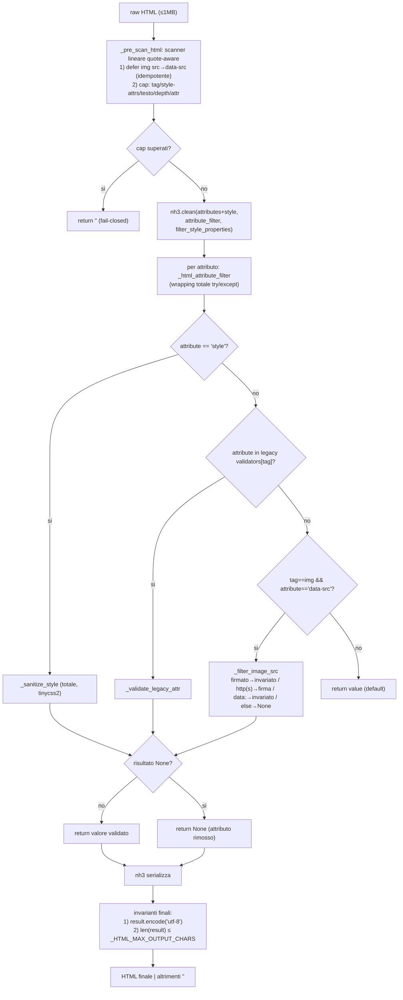
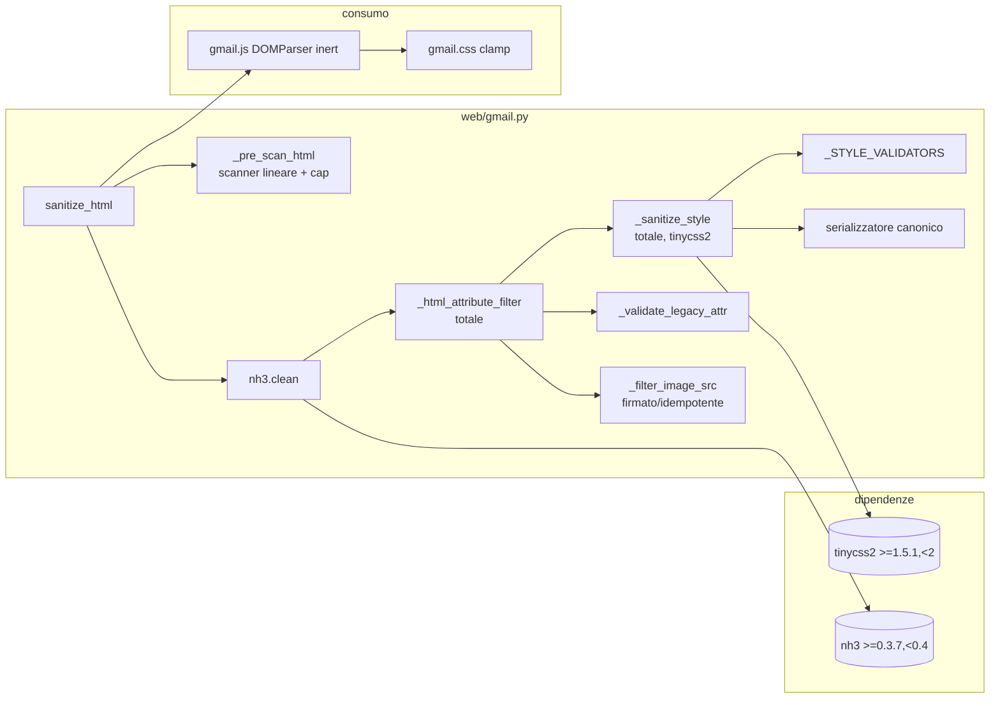

# Design — Fase 1 rendering HTML Gmail (CSS inline sicuro + layout tabellare)

> **Nota (mc-im6):** il servizio Gmail descritto qui come `web/gmail.py` ora vive in
> `server/gmail.py` (core) e le sue funzioni sono esposte come operazioni `gmail.*`
> (`server/ops/gmail.py`); `web/gmail_api.py` si limita a tradurle in HTTP. I percorsi
> `web/gmail.py` e i numeri di riga qui sotto descrivono il codice com'era al momento
> del design. Vedi `docs/DESIGN_CLIENT_SERVER_SPLIT.md` §13.

Data: 2026-10-24 · Branch: `master` (pulito) · Stato: **rev. 6** (post red-team round 6: idempotenza cap testo/attr via worst-case, border-radius longhand/no-space) · Ambito: solo reader HTML Gmail (`web/gmail.py`, `web/static/gmail.css`/`gmail.js`, `tests/test_gmail_html.py`, `requirements-web.txt`/`requirements-dev.txt`, `install.sh`, `README.md`, `docs/DESIGN_GMAIL_POC.md`).

> **Fase 1 only.** Niente iframe, niente `<style>`, niente classi/id, niente rendering browser-side, nessun cambio REST/UX. Il toggle HTML/testo resta invariato. Nessuna modifica a P2/P3 Gmail. Fast track **non** attiva: gate red team obbligatorio.

> **Revisione 6** — chiude il sesto gate. **Idempotenza cap testo/attr (blocker)**: i cap contano il raw, ma un output ≤1 MB con entità espanse poteva superarli alla seconda passata e diventare `""`. Garanzia scelta (worst-case, semplice e verificabile): `_HTML_MAX_TEXT_CHARS = 1_000_000` (= output cap) e `_HTML_MAX_ATTR_LEN = 16_384` (≥ 6 × `_STYLE_SERIALIZED_MAX`=2048); più `_ATTR_VALUE_MAX_LEN=2048` (attr generici) e `_IMAGE_URL_MAX_LEN=4096` (token proxy ≈5,5 KB) così **ogni attributo emesso è < 16_384** e **ogni output ≤1 MB è ri-accettato** ⇒ idempotenza. Trade-off DoS documentato (testo 1 MB + restrizioni CSS + output cap). **Minor**: `border-radius` no-space (`10px/20px`) e longhand (`border-top-left-radius:10px 20px`, 1–2 raggi senza `/`). Picco escaping già documentato. Vedi §3.

---

## 1. Stato attuale (con file:riga)

| Componente | Posizione | Descrizione |
|---|---|---|
| Allow-list tag | `web/gmail.py:80-134` (`_ALLOWED_HTML_TAGS`) | Tag consentiti; include tutte le tag tabellari. |
| Allow-list attributi | `web/gmail.py:135-145` (`_ALLOWED_HTML_ATTRIBUTES`) | `href/title`, `span`, `alt/data-src/height/width`, `align/width`, `align/colspan/rowspan/valign/width`, `scope`, `start`, `value`. **`style` e `class` non ammessi.** |
| Tag rimossi con contenuto | `web/gmail.py:146-162` (`_CLEAN_CONTENT_TAGS`) | Include `<style>`. |
| Defer immagini | `web/gmail.py:1524-1537` (`_defer_image_sources`) | Regex non idempotente/fragile (§1.1 p.6). |
| Filtro attributi | `web/gmail.py:1547-1555` (`_html_attribute_filter`) | Solo `img`/`data-src`; non riconosce `data-src` già firmato (§1.1 p.8). |
| **Entry point** | `web/gmail.py:1558-1588` (`sanitize_html`) | `nh3.clean` + try/except top-level. **Non** usa `filter_style_properties`; nessun cap output. |
| Limite HTML | `web/gmail.py:53` (`_MAX_HTML_CHARS = 1_000_000`) | Solo cap input; nessun cap su tag/style/testo/depth/attr/output. |
| Token immagine | `web/gmail.py:1497-1503` (`sign_image_url`) | Token = `{base64url}.{hexdigest[:32]}`, path `/gmail-image?token=…&v=2`. `verify_image_token` (1506-1521) usa `partition(".")` + HMAC. |
| Siti d'uso | `web/gmail.py:1591-1598`, `web/gmail.py:2094` | Entrambi da `sanitize_html`. |
| Inserimento DOM | `web/static/gmail.js:707-757`, `725-728` | `DOMParser` inert + spostamento nodi. |
| Clamp contenitore | `web/static/gmail.css:399-416`, `446-483` | `.gmail-reader-body` overflow auto + `overflow-wrap:anywhere`; `.gmail-html-content` `max-width:720px`; `table/img{max-width:100%}`. |
| Test | `tests/test_gmail_html.py` | **9** test unitari (§1.3). |
| Dipendenze | `requirements-web.txt:8`, `requirements-dev.txt:25` | `nh3>=0.3.7,<0.4`. `tinycss2` **non installato**. |
| Installer | `install.sh:639-648` (`setup_gmail`) | Solo `nh3`. |
| CSP | `web/gmail_api.py:88` | CSP `default-src 'none'` solo proxy immagini; nessuna CSP SPA. |
| Doc "no styles" | `README.md:716`, `docs/DESIGN_GMAIL_POC.md:14,53,167,196` | Da aggiornare (minor). |
| Licenza progetto | `LICENSE` | GPL-3.0. |

### 1.1 Comportamenti verificati empiricamente (nh3 0.3.7 + tinycss2 1.5.1)

1. **`filter_style_properties` filtra per nome, non per valore** (`color:expression(…)`/`list-style:url(…)` passano se il nome è ammesso).
2. **`!important` non rimosso da nh3**, riscritto `! important`.
3. **Wildcard `"*"`** supportata in `attributes`.
4. **`attribute_filter` riceve il valore decodificato** e il return diventa l'output; `None` elimina l'attributo.
5. **`attribute_filter` fail-open**: eccezione o lone surrogate → nh3 conserva il valore raw.
6. **`_defer_image_sources` non idempotente/fragile** (`data-src`→`data-data-src`, `>` in `alt`, `src=` in `style`).
7. Firma `nh3.clean`: `filter_style_properties` presente; **non esiste** `generic_attributes`.
8. **Immagini firmate non idempotenti**: `sanitize_html('')` → `data-src="/gmail-image?token=…&amp;v=2"`; seconda passata → ``. `verify_image_token` valida.
9. **tinycss2 — `skip_whitespace=True` preserva gli whitespace interni** (`font-family: Times New Roman, Arial` identico con True/False; `False` include anche leading/trailing del valore). Il bug multi-word era nel serializzatore, non nel flag.
10. **tinycss2 — `Declaration.name` è già lowercase**; escape risolti (`c\6flor` → `color`).
11. **tinycss2 — `!important` NON è nel valore** (`Declaration.important=True`); `!garbage` è nel valore come `LiteralToken('!')` + ident.
12. **tinycss2 — escape surrogate**: `font-family:'\D800'` → `StringToken` `'\ud800'` (Cs).
13. **tinycss2 — `parse_declaration_list` restituisce anche item non-Declaration** (`AtRule`, `WhitespaceToken`).
14. **Misurazioni (§10)**: `nh3.clean` 1 MB flat ≈93 ms; 20k `div` annidati ≈11.5 s (superlineare ⇒ cap profondità); tinycss2 parse+serialize 15 decl/321 B ≈0.58 ms, 64 decl/1.2 KB ≈2.55 ms.
15. **`sign_image_url`**: token = `{base64url}[A-Za-z0-9_-]+` + `.` + `{32 hex}[0-9a-f]{32}`; `verify_image_token` usa `partition(".")` → un token con più `.` fallisce l'HMAC (ritorna `""`).

### 1.2 Lacune attributi legacy (M6)

`col/colgroup span`, `ol start`, `li value`, `th scope`, `align`, `valign`, `colspan`, `rowspan`, `width`, `height` ammessi **senza validazione valore**. Da chiudere (§6).

### 1.3 Test esistenti (9)

`test_sanitize_strips_scripts_and_event_handlers`, `test_sanitize_keeps_safe_links_and_drops_javascript`, `test_sanitize_strips_styles_and_remote_resources`, `test_sanitize_keeps_basic_tables`, `test_sanitize_rejects_oversized_html`, `test_parse_message_returns_sanitized_html`, `test_sanitize_keeps_safe_layout_table_attributes`, `test_sanitize_rejects_unsafe_image_sources`, `test_image_proxy_token_roundtrip_and_tamper`.

---

## 2. Architettura

### 2.1 Flusso (pipeline aggiornata)



**Ordine** in `sanitize_html`: (1) `_pre_scan_html(raw)`; (2) `nh3.clean(...)`; (3) invarianti finali (UTF-8 + output cap). **Guard order (B5)**: `style` → legacy → `img data-src` → default.

### 2.2 Componenti



---

## 3. Risoluzione review red team

### Round 1–3 — confermati

| ID | Stato | Sintesi |
|---|---|---|
| B1 | ✅ | Callback totale + invarianti finali fail-closed. |
| B2 | ✅ | Scanner lineare + cap pre-nh3 misurati. |
| B3 | ✅ | px esatti + limiti layout + long-word (`keep-all`/`overflow-wrap:normal` rimossi). |
| B4 | ✅ | Scanner idempotente + `_filter_image_src` riusa token firmati. |
| B5 | ✅ | Guard order `style`→legacy→`img data-src`→default. |
| M1 | ✅ | `!important` rimosso; `LiteralToken('!')` rifiutato; metrica CSS-only. |
| M4 | ✅ | `install.sh`/README/POC + `tinycss2`. |
| M5 | ✅ | Kill switch `GMAIL_HTML_STYLES`. |
| M6 | ✅ | Tutti i legacy validati + bound bassi. |
| M7 | ✅ | CSP `style-src-attr 'unsafe-inline'` documentata. |
| M8 | ✅ | `filter_style_properties` da `_STYLE_VALIDATORS`; post-check `style=""`. |

### Round 4 (correzioni richieste)

| ID | Stato | Modifica | Test |
|---|---|---|---|
| **Blk 1** (M2 separatori) | ✅ | `WhitespaceToken` interni = **separatori** per proprietà multi-value (`margin`, `padding`, `border`, `border-spacing`, `border-radius`, `text-decoration`, …); solo `font-family` grouping per virgola; single-value rifiutano `WhitespaceToken` residuo. §7.3 riscritto senza contraddizioni. | `margin:0 auto`, `padding:8px 12px`, `border:1px solid #ccc`, `border-spacing:2px 4px`, `text-decoration:underline overline`, `border-radius:4px 8px`. |
| **Blk 2** (P1) | ✅ | P1 input ≤950 KB (margine), testo ≈200 KB (≈21%, coerente), output non vuoto e ≤ cap; `_HTML_MAX_OUTPUT_CHARS` con picco di escaping documentato (≈6×). Target misurato. §10. (Supersede: cap output **allineato a 1 MB** in round 5.) | Test output non vuoto e ≤ cap su P1; input entity-heavy ≤ cap. |
| minor (escaping) | ✅ | Documentato picco di escaping (§8.1): `"`→`&quot;` (6×), `&`→`&amp;` (5×), `<`/`>`→4×; output cap è il fail-closed. | — |
| minor (B4 multi-`.`) | ✅ | Regex stretta `^/gmail-image\?token=([A-Za-z0-9_-]+)\.([0-9a-f]{32})(?:&v=\d+)?$` (una sola `.`, 32 hex). | Token reale (1 `.`) → invariato; token con più `.` → rimosso; tampered → rimosso. |
| minor (P1 80%/200KB) | ✅ | P1 ridefinito con percentuale coerente (≈21%). | — |
| minor (tabella round 4) | ✅ | §3 aggiornata. | — |

### Round 5 (blocker residuo + rifiniture)

| ID | Stato | Modifica | Test |
|---|---|---|---|
| **Blk** (cap output/input) | ✅ | `_HTML_MAX_OUTPUT_CHARS = 1_000_000 = _MAX_HTML_CHARS` (output **≤** input). Elimina la fascia (1 MB, 1,1 MB] che rompeva l'idempotenza: output ≤1 MB è ri-parsabile, output che eccederebbe 1 MB → `""`. P1 (950 KB → ~955 KB) < 1 MB. §5.2/§10. | output > cap ⇒ `""`; output al limite ≤ cap ⇒ idempotente; P1 non vuoto; entity-heavy idempotente. |
| Rifinitura (`_STYLE_SERIALIZED_MAX`) | ✅ | Alzato da 1024 a **2048** (il CSS canonicalizzato può eccedere l'input; `_STYLE_MAX_LEN=1024` resta per l'input). P2 style ~1 KB non più scartati. | Test output canonico > input (`color:rgb(255,0,0)` → `color:rgb(255, 0, 0)`). |
| Rifinitura (`border-radius` `/`) | ✅ | `border-radius` accetta la forma ellittica `[raggi]{1,4} [ / [raggi]{1,4} ]?` (max una `/`), raggi ≥0 ≤64px/≤100%. | `border-radius:10px / 20px`, `4px 8px / 4px 8px` → ok; `10px / 20px / 30px` (2 slash) → rifiutato. |
| Rifinitura (escaping) | ✅ | Picco di escaping post-nh3 già documentato (§8.1); accettato, nessuna azione oltre la nota. | — |

### Round 6 (idempotenza cap testo/attr + minor)

| ID | Stato | Modifica | Test |
|---|---|---|---|
| **Blk** (cap testo/attr vs escaping) | ✅ | Garanzia worst-case: `_HTML_MAX_TEXT_CHARS=1_000_000` (= output cap) e `_HTML_MAX_ATTR_LEN=16_384` (≥6×`_STYLE_SERIALIZED_MAX`); `_ATTR_VALUE_MAX_LEN=2048` e `_IMAGE_URL_MAX_LEN=4096` ⇒ ogni attributo emesso <16_384, ogni output ≤1 MB ri-accettato ⇒ idempotente. Trade-off DoS documentato (§5.2b). | 100KB di `&`, style 2048 ricco di quote, output ≤1 MB ⇒ idempotente; output > cap ⇒ `""`. |
| minor (border-radius no-space/longhand) | ✅ | `border-radius` accetta `/` con o senza spazi (`10px/20px` ≡ `10px / 20px`); longhand (`border-top-left-radius` ecc.) 1–2 raggi **senza** `/`. | `10px/20px`, `border-top-left-radius:10px 20px` → ok; longhand con `/` → rifiutato. |
| minor (escaping) | ✅ | Già documentato (§8.1). | — |

---

## 4. Fail-closed del callback (B1), dipendenza, kill switch

### 4.1 Garanzia fail-closed (B1)

1. **`_html_attribute_filter` totale** — `try: … except Exception: return None`.
2. **`_sanitize_style` totale e UTF-8-safe** — non lancia; `cleaned.encode("utf-8")`; rifiuta Cc (eccetto `\t\n\r\f`), Cf, Cs, noncharacters, `U+007F`.
3. **Invarianti finali** in `sanitize_html` — `result.encode("utf-8")` e `len(result) ≤ _HTML_MAX_OUTPUT_CHARS`; su violazione → `""`.

Post-pass scartato (ridondante). **Test B1**: lone surrogate (anche `\D800`) in `style`/testo, control-char, validatore che solleva, `1e999`/`NaN`.

### 4.2 Dipendenza `tinycss2` (confermata)

`tinycss2>=1.5.1,<2` (runtime, `requirements-web.txt`/`requirements-dev.txt`). Pure Python, BSD-3-Clause (GPL-compatibile), `requires_python>=3.10`. Transitive `webencodings>=0.4` (BSD, frozen/stable): **valutato, non pinnato**. Import lazy; warning una volta. Fallback `None` (stile rimosso).

**Alternative scartate:** parser custom, `bleach`, solo `filter_style_properties`, `tag_attribute_values`.

### 4.3 Kill switch (M5)

`GMAIL_HTML_STYLES` (default `"1"`). Off ⇒ `_html_attribute_filter` → `None` per `style`; legacy tabellari invariati. Test on/off.

---

## 5. Scanner lineare, cap di complessità, immagini idempotenti

### 5.1 `_pre_scan_html(raw)` — scanner lineare quote-aware

Sostituisce `_defer_image_sources`. Single-pass O(n), stato `in_tag`/`quote`/buffer. Specifiche:
- **Case-insensitive** su nomi tag/attributi.
- **Void tag**: `br hr img meta link col area base embed source track wbr input`.
- **Commenti** `<!-- -->`, **raw text** `script/style/textarea/title`, **CDATA** `<!…>`/`<![CDATA[…]]>`, **`<` nel testo**, **attributi unquoted**, **`>` in quote** gestiti.
- Defer `src`→`data-src` **solo** per nome-attributo reale; idempotente.
- Conta: tag aperti (escluso `tbody`), attributi `style`, lunghezza testo, profondità, attr/tag, lunghezza max attr.

### 5.2 Cap di complessità (B2, misurati)

| Cap | Valore | Effetto |
|---|---|---|
| `_MAX_HTML_CHARS` | 1_000_000 | input (esistente) |
| `_HTML_MAX_TAGS` | 8_000 | oltre ⇒ `""`; **`tbody` escluso** |
| `_HTML_MAX_STYLE_ATTRS` | 400 | oltre ⇒ `""` |
| `_HTML_MAX_TEXT_CHARS` | **1_000_000 (= output cap)** | oltre ⇒ `""` (§8; DoS testuale delegato a input/output cap + restrizioni CSS) |
| `_HTML_MAX_DEPTH` | 128 | oltre ⇒ `""` (nh3 superlineare); **`tbody` escluso** dal conteggio |
| `_HTML_MAX_ATTRS` | 256/tag | oltre ⇒ `""` |
| `_HTML_MAX_ATTR_LEN` | **16_384** | oltre ⇒ `""` (≥ 6 × `_STYLE_SERIALIZED_MAX`=2048 → 12_288, con margine) |
| `_ATTR_VALUE_MAX_LEN` | 2_048 | attributi generici (`href`/`title`/`alt`) oltre ⇒ `None` (emesso ≤6×2048=12_288 < 16_384) |
| `_IMAGE_URL_MAX_LEN` | 4_096 | URL immagine oltre ⇒ `None` (token firmato ≈5,5 KB < 16_384) |
| `_HTML_MAX_OUTPUT_CHARS` | **1_000_000 (1 MB, = input)** | output oltre ⇒ `""` (§8) |

- **`tbody` escluso** da conteggio tag **e profondità** (nh3 può sintetizzarlo) → idempotenza al limite.
- Oltre cap ⇒ `""` (reader passa al testo). Cap **prima** di nh3.
- **Output cap 1 MB = input cap** (non 1,1 MB): garantisce l'idempotenza — ogni output ≤1 MB è ri-parsabile (input cap 1 MB) e qualunque output che eccederebbe 1 MB viene rifiutato (`""`), quindi `sanitize_html(sanitize_html(x)) == sanitize_html(x)`. Non esiste più la fascia (1 MB, 1,1 MB] che la rompeva. Le aggiunte di nh3 su contenuto legittimo (`rel="noopener noreferrer"`, `<tbody>` sintetico, token proxy, escaping) sono assorbite dal margine di P1 (950 KB → ~955 KB). Picco di escaping documentato (§8.1).

### 5.2b Invariante di idempotenza dei cap testo/attr (round 6)

I cap testo/attr contano il **raw**. Perché l'idempotenza valga, ogni output `O` con `len(O) ≤ _HTML_MAX_OUTPUT_CHARS` deve essere **ri-accettato** alla seconda passata. Garanzia scelta (semplice e verificabile, worst-case):

1. **Testo**: `_HTML_MAX_TEXT_CHARS = 1_000_000` (= output cap). Qualunque `O ≤ 1 MB` ha testo ≤ 1 MB ⇒ ri-accettato. Trade-off DoS documentato: il DoS da testo è ora contenuto dai cap input/output (1 MB) e dalle restrizioni CSS (§8.1: niente `white-space:nowrap/pre`, niente `word-break:keep-all`/`overflow-wrap:normal`, `letter-spacing` ≤8px), che impediscono il layout-bomb da long-word anche su 1 MB.
2. **Attributi**: ogni attributo **emesso** è ≤ `_ATTR_VALUE_MAX_LEN=2048` (generici) o ≤ `_STYLE_SERIALIZED_MAX=2048` (style) o ≈5,5 KB (token proxy, `_IMAGE_URL_MAX_LEN=4096`). nh3 li ri-escapa al più 6× (`"`→`&quot;`) ⇒ ogni attributo in `O` è < `_HTML_MAX_ATTR_LEN=16_384` ⇒ ri-accettato. Il CSS canonicalizzato è quote/`&`-free (serializzazione senza stringhe), quindi l'amplificazione reale dello style è ≈1×; il bound 6× è una difesa worst-case.
3. **Tag/style-attrs/profondità** sono monotoni non crescenti da raw a output (escluso `tbody`), quindi i cap non scattano alla ri-passata.

Conseguenza: `sanitize_html(sanitize_html(x)) == sanitize_html(x)` per ogni `x` (output ≤ cap ri-accettato; output > cap ⇒ `""` che è idempotente).

### 5.3 Immagini firmate idempotenti (B4, regex stretta)

`_filter_image_src(value)` per `tag=="img" and attribute=="data-src"` (dopo `style`/legacy, B5):

```text
value = value.strip()
1. se _SIGNED_IMAGE_RE.fullmatch(value):
     token = m.group(1) + "." + m.group(2); verify_image_token(token)
     valido  → return value INVARIATO
     invalido → return None
2. altrimenti se _SAFE_IMAGE_DATA_RE.match(value) → return value INVARIATO
3. altrimenti se _safe_image_source(value) (http/https) → return sign_image_url(value)
4. altrimenti → return None
```

**Regex formale (stretta, una sola `.`, 32 hex)** — coerente con `sign_image_url` (§1.1 p.15):

```text
_SIGNED_IMAGE_RE = ^/gmail-image\?token=([A-Za-z0-9_-]+)\.([0-9a-f]{32})(?:&v=\d+)?$
```

- Un token con **più `.`** non matcha (o `verify_image_token` fallisce l'HMAC) → rimosso.
- nh3 consegna il valore **decodificato** (`&amp;`→`&`); il match opera su `…&v=2`; nh3 ri-escapa in uscita → output identico alla ri-passata.

**Test B4**: ``, ``, `">` (→ invariato), `">` (→ rimosso), `">` (→ rimosso), `` (→ invariato), doppia passata idempotente.

---

## 6. Tabelle e attributi legacy (M6)

`_LEGACY_ATTR_VALIDATORS` applicati in `attribute_filter` prima del ramo `img/data-src` (B5). Valore non valido → `None`.

| Tag | Attributo | Valori / bound |
|---|---|---|
| `table` | `border`, `cellpadding`, `cellspacing` | intero 0–50 |
| `table` | `bgcolor` | `#` + 3/6 hex |
| `table` | `width` | intero 0–10000 · % 0–100 |
| `table` | `height` | intero 0–2000 · % 0–100 |
| `table` | `align` | `left right center justify` |
| `tr` | `bgcolor`, `height`, `align`, `valign` | come sopra; `valign` ∈ `top middle bottom baseline` |
| `td`, `th` | `bgcolor`, `height` | come sopra |
| `td`, `th` | `align`, `valign`, `colspan`, `rowspan`, `width` | `colspan/rowspan` intero 1–100; resto come sopra |
| `th` | `scope` | `row col rowgroup colgroup` |
| `col`, `colgroup` | `span` | intero 1–100 |
| `col`, `colgroup` | `width`, `bgcolor`, `align`, `valign` | come sopra |
| `ol` | `start` | intero −10000…10000 |
| `li` | `value` | intero −10000…10000 |
| `img` | `width`, `height` | `width` 0–10000 · `height` 0–2000 |
| `img` | `align` | `left right top middle bottom` |

- **`nowrap` rimosso** (equivalente `white-space:nowrap`, rifiutato §7.2).

---

## 7. Allow-list proprietà CSS e validazione valori

### 7.1 Elenco proprietà

| Categoria | Proprietà | Valori ammessi |
|---|---|---|
| Colori | `color`, `background-color` | `<color>` |
| Font | `font-family` | lista virgole di ident/string (max 8 famiglie, max 128 char l'una); no `url()/var()/inherit/initial/unset/revert`/control/surrogate; **whitespace interni preservati** (§7.3) |
| Font | `font-size` | `<len-assoluto>` ≤48px · keyword `xx-small x-small small medium large x-large xx-large` · **no `%`, no `larger/smaller`** |
| Font | `font-style` | `normal italic oblique` |
| Font | `font-weight` | `normal bold bolder lighter` · intero 100–900 |
| Font | `font-variant` | `normal small-caps` |
| Testo | `line-height` | `normal` · numero 1–3 · `<len-assoluto>` 1–200px · no `%` |
| Testo | `letter-spacing` | `normal` · `<len-assoluto>` ≤8px |
| Testo | `text-align` | `left right center justify start end` |
| Testo | `text-decoration` | `none underline overline line-through` (1–3, ws-separati) |
| Testo | `text-transform` | `none capitalize uppercase lowercase` |
| Testo | `white-space` | `normal pre-wrap pre-line` (rifiutati `pre`, `nowrap`) |
| Testo | `word-break` | `normal break-all break-word` (rimosso `keep-all`) |
| Testo | `overflow-wrap` | `break-word anywhere` (rimosso `normal`) |
| Box | `margin`, `margin-*` | 1–4 `<len>`/`%`/`auto` (ws-separati); ±256px, ±100% |
| Box | `padding`, `padding-*` | 1–4 `<len>`/`%` (ws-separati); ≥0, ≤256px, ≤100% |
| Bordi | `border`, `border-*` | `<line-width>? <line-style>? <color>?` (ws-separati, ordine libero) |
| Bordi | `border-width/style/color` (+lati) | width `thin medium thick`/`<len>` ≤8px; style enum; `<color>` (1–4 valori) |
| Bordi | `border-radius` (shorthand) | `<len>`/`%` ≥0 ≤64px, ≤100% (1–4 valori); forma ellittica `[raggi]{1,4} [ / [raggi]{1,4} ]?` (max una `/`, con o senza spazi attorno) |
| Bordi | `border-top-left-radius`, `border-top-right-radius`, `border-bottom-right-radius`, `border-bottom-left-radius` | `<len>`/`%` ≥0 ≤64px, ≤100% (1–2 valori, **senza** `/`) |
| Tabelle | `border-collapse` | `collapse separate` |
| Tabelle | `border-spacing` | 1–2 `<len>` ≥0 ≤32px (ws-separati) |
| Tabelle | `table-layout` | `auto fixed` |
| Tabelle | `vertical-align` | `baseline top middle bottom sub super text-top text-bottom` · `<len>` ≤128px |
| Layout | `width`, `height` | `<len>` ≥0 ≤1600px · `%` ≤100% · `auto` |
| Layout | `float` | `left right none` |
| Layout | `display` | `block inline inline-block none list-item table table-row table-cell table-row-group table-header-group table-footer-group table-column table-column-group inline-table` |

**Shorthand ammessi:** `margin`, `padding`, `border` (+lati). **Esclusi:** `background`, `font`, `list-style`, `outline`.

### 7.2 Valori, unità, funzioni

**Unità di lunghezza** (solo assolute, px esatti): `px`=1 · `pt`=4/3 · `pc`=16 · `in`=96 · `cm`=96/2.54 · `mm`=96/25.4 · `q`=96/101.6. `em/rem/ex/ch` rifiutati; confronto sul px-equivalente; rifiutare non-finiti (`1e999`/`NaN`). `%` solo su `width/height/margin/padding/border-radius` (0–100; margin ±100).

**Funzioni consentite (chiuso):** `rgb()`, `rgba()`, `hsl()`, `hsla()`. Ogni altra `FunctionBlock` rifiutata (`url`, `image-set`, `image`, `cross-fade`, `element`, `expression`, `calc`, `var`, `env`, `attr`, `min`, `max`, `clamp`, `counter`, `counters`, `local`, `format`, `color`, `lab`, `lch`, `oklab`, `hwb`, `color-mix`).

**Colori:** ident named + `transparent` + `currentColor`; hex 3/4/6/8; le 4 funzioni.

**`!important` (M1):** dichiarazione mantenuta, flag rimosso (mai serializzato); `LiteralToken('!')` nel valore → rifiutata. Metrica CSS-only (§10).

**Token rifiutati:** `URLToken`, `BadURLToken`, `BadStringToken`, `AtKeywordToken`, `CurlyBracketsBlock`/`SquareBracketsBlock`, `SemicolonToken`, Cc (eccetto `\t\n\r\f`), Cf, Cs, noncharacters, `<`/`>`.

**Keyword globali:** `inherit/initial/unset/revert` rifiutati ovunque, incluso `font-family`.

### 7.3 Parsing, separatori e serializzazione canonica (M2 corretto)

- `tinycss2.parse_declaration_list(value, skip_whitespace=False, skip_comments=True)`.
- **Normalizzazione**: strip dei `WhitespaceToken` leading/trailing del valore → `tokens` normalizzati.

**Regola unificata sui separatori (correzione M2):**

1. **Proprietà multi-value** (`margin`, `padding`, `border`, `border-width/style/color` shorthand, `border-spacing`, `text-decoration`, `border-radius`, e gli shorthand a N componenti): gli `WhitespaceToken` **interni sono separatori**. Il validatore splitta su `WhitespaceToken` in **componenti tight** (1 token ciascuno), valida ogni componente e il conteggio (es. `margin` 1–4, `border-spacing` 1–2, `text-decoration` 1–3). `border` accetta i componenti `width`/`style`/`color` in ordine libero. **`border-radius`** (shorthand) ammette al più una `LiteralToken('/')` **con o senza spazi attorno** (`10px / 20px` ≡ `10px/20px`): due gruppi di 1–4 raggi ciascuno (forma ellittica); ogni raggio ≥0 ≤64px/≤100%. I **longhand** `border-top-left-radius` ecc. accettano 1–2 raggi **senza** `/`.
2. **`font-family` (unico grouping per virgola)**: split su `LiteralToken(',')` in famiglie; dentro ogni famiglia, join di `IdentToken`/`StringToken` con **spazio singolo** (collapse `WhitespaceToken`) → `"Times New Roman, Arial"`. Altri token → rifiutato.
3. **Proprietà single-value** (`color`, `font-size`, `font-weight`, `display`, `float`, `text-align`, `white-space`, `border-collapse`, `table-layout`, …): dopo lo strip, il valore deve essere **un solo componente tight**; qualunque `WhitespaceToken` residuo (o secondo componente) → rifiutato.

**Serializzazione canonica:**
- Funzioni colore: `rgb(255, 0, 128)`, `rgba(0, 0, 0, 0.5)`, `hsl(210, 50%, 50%)`, `hsla(...)` (spazi dentro le funzioni normalizzati).
- Multi-value: componenti riserializzati e uniti con **spazio singolo** (`margin:0 auto`, `padding:8px 12px`, `border:1px solid #ccc`, `border-spacing:2px 4px`, `text-decoration:underline overline`, `border-radius:4px 8px`, `border-radius:10px / 20px`, `border-top-left-radius:10px 20px`).
- `font-family`: famiglie unite con `", "`.
- **Mai** riuso del testo grezzo.
- **M8 post-check**: input `style` non vuoto con 0 dichiarazioni valide → `None` (mai `style=""`); serializzazione vuota → `None`.

**Cap output/early-cap:** `_STYLE_MAX_LEN=1024` (input), `_STYLE_MAX_DECLS=32` (early-bail), `_STYLE_SERIALIZED_MAX=2048` (output; **> input** perché la canonicalizzazione può espandere `#fff`→`rgb(...)`/aggiungere spazi).

---

## 8. Sicurezza

### 8.1 Matrice vettori

| Vettore | Blocco |
|---|---|
| Resource load (`url()`, `image-set()`, `@import`, `@font-face`, `src`) | funzioni non-chiuse rifiutate; at-rule rifiutate; shorthand esclusi; `url()` rifiutato a token |
| Exfiltration CSS (`@media`/`@supports`) | at-rule rifiutate; nessun `<style>` |
| UI redressing (`position`, `z-index`, `inset`, …) | non in allow-list |
| `expression`/`behavior`/`-moz-binding`/`-ms-filter` | non in allow-list + funzioni rifiutate |
| `var()/env()/attr()` e `--*` | rifiutati |
| `!important` | flag rimosso (M1) |
| Overflow dimensionale | px esatti + `%` limitato + limiti layout (B3) + clamp contenitore |
| Long-word (no break) | `word-break:keep-all`/`overflow-wrap:normal` rimossi (B3); container `overflow-wrap:anywhere` backstop |
| DoS (deep/wide, testo enorme) | scanner lineare + cap pre-nh3 (B2); profondità cap 128; testo contenuto da input/output cap 1 MB + restrizioni CSS (§5.2b) |
| Amplificazione entità output | `_HTML_MAX_OUTPUT_CHARS=1 MB` (= input, fail-closed) |
| Attributi legacy malformati | validazione completa + bound bassi (M6) |
| Lone surrogate / control / nonchar | rifiutati + invariante UTF-8 (B1) |

**Picco di escaping (documentato, accettato):** nh3 può espandere `"`→`&quot;` (6×) nei valori attributo, `&`→`&amp;` (5×), `<`→`&lt;`/`>`→`&gt;` (4×). Peggior caso teorico ≈6×. L'output cap 1 MB (= input) è il fail-closed: contenuto legittimo amplifica ≈1,0× (P1 950 KB → ~955 KB, assorbito dal margine), una entity-bomb amplifica 5–6× e viene rifiutata. Poiché output ≤ input, l'idempotenza è garantita. Nessuna stima pre-nh3 necessaria (valutato: il cap post-nh3 è sufficiente e più semplice).

### 8.2 CSP (M7)

SPA senza CSP; CSP `default-src 'none'` solo proxy immagini. **Requisito**: output usa solo attributi `style=` (no `<style>`/`<link>`/`class`/`id`) ⇒ CSP futura `style-src-attr 'unsafe-inline'`, `style-src 'none'/'self'`, `script-src` senza `unsafe-inline`. Test strutturale.

### 8.3 Modello di minaccia

1. Nessun JS. 2. Nessuna risorsa remota non mediata. 3. Nessun posizionamento fuori box. 4. Fail-closed ovunque. 5. Difesa in profondità.

---

## 9. Test

### 9.1 Regressione (9 test esistenti)

`test_sanitize_strips_styles_and_remote_resources` resta verde (`background` fuori allow-list → attributo rimosso). Gli altri 8 invariati. **Nessuna modifica alle 9 funzioni.**

### 9.2 Nuovi casi (asserzioni strutturate)

Le asserzioni **separano testo email dai `style`** (valori `style` parsati con `tinycss2.parse_declaration_list`); assert su dichiarazioni/token (no substring globali).

1. **Colori**: `color:#fff`, `rgb(1,2,3)`, `background-color:#00ff00`, `hsl(0,100%,50%)`, named, `transparent`, `currentColor`.
2. **Abuso colore (B5)**: `color:url(…)`, `color:var(--x)`, `color:expression(…)`, `image-set(…)`, `color(display-p3…)`, `hwb()`, `lab()`.
3. **Multi-value (M2)**: `margin:0 auto`, `margin:1px 2px 3px 4px`, `padding:8px 12px`, `border:1px solid #ccc`, `border:1px`, `border-spacing:2px 4px`, `border-spacing:2px`, `text-decoration:underline overline`, `border-radius:4px 8px` → preservati e canonici.
4. **`border-radius` `/` e longhand (round 5/6)**: `border-radius:10px / 20px`, `border-radius:10px/20px` (no-space), `border-radius:4px 8px / 4px 8px`, `border-top-left-radius:10px 20px` → ok; `border-radius:10px / 20px / 30px` (2 slash), `border-top-left-radius:10px / 20px` (longhand con `/`) → rifiutati.
5. **Shorthand/network**: `background:url(…)`, `background-image`, `border-image`, `list-style:url(…)`, `cursor:url(…)`, `content:url(…)`, `filter:url(…)`, `mask:url(…)`, `-webkit-box-reflect`.
6. **Posizionamento**: `position:*`, `z-index`, `inset`, `top/right/bottom/left`.
7. **`!important` (M1)**: `color:red !important` → `color:red`; `!garbage` → rifiutata; nessun `LiteralToken('!')` nei CSS; il testo può contenere `!`.
8. **At-rule**: `@import`, `@font-face`, `@media`, `@supports`.
9. **`var()/env()/attr()` + custom props**: `--x:1`, `color:var(--x)`, `width:env(...)`.
10. **Escape CSS**: `c\6flor:red` → `color:red`; malformato → eliminata.
11. **Whitespace/commenti (M2)**: commenti scartati; `rgb( 1 , 2 , 3 )` → `rgb(1, 2, 3)`; `font-family: Times New Roman, Arial` preservato; `\t\n\r\f` ok, altri Cc rifiutati; idempotenza.
12. **Canonico > input (round 5)**: `color:rgb(255,0,0)` → `color:rgb(255, 0, 0)` (output canonico più lungo dell'input) → preservato, non scartato da `_STYLE_SERIALIZED_MAX`.
13. **Bound (B3)**: `width:1600in`, `font-size:72pt`/`56px`, `padding:256em`, `font-size:400%`/`larger`, `line-height:0.5`/`4`, `letter-spacing:20px`, `white-space:nowrap`/`pre`, `word-break:keep-all`, `overflow-wrap:normal` → rifiutati; `line-height:1.5`, `letter-spacing:8px`, `white-space:pre-wrap`, `word-break:break-all`, `overflow-wrap:anywhere` → ok.
14. **Legacy (M6)**: validi preservati; invalidi rifiutati (`width="-5"`, `bgcolor="javascript:…"`, `colspan="0"`, `span="999"`, `height="9999"`, `nowrap`).
15. **Fallback (B1/M4)**: `ImportError` tinycss2, validatore che solleva, `1e999`/`NaN`.
16. **Surrogate (M3, escape)**: `font-family:'\D800'` → rifiutata; lone surrogate nel testo → `""`.
17. **Kill switch (M5)**: off ⇒ stile rimosso, legacy preservati.
18. **Idempotenza (B4)**: `sanitize_html(sanitize_html(x)) == sanitize_html(x)` per img, `data-src` http(s), `data-src="/gmail-image?token=…"` (reale/tampered/più-`.`/`&amp;`), `>` in alt/URL, `src=` in style, tabella al limite (tbody).
19. **Difesa in profondità (M8)**: `style=""` → rimosso; `style="background:url(…)"` → rimosso (mai `style=""`).
20. **Cap output (round 5)**: output > `_HTML_MAX_OUTPUT_CHARS` ⇒ `""`; output al limite ≤ cap ⇒ idempotente; P1 → output non vuoto e ≤ cap; input entity-heavy (`&`, `<`, `>`, `"`) e style con escaping → output ≤ cap e idempotente.
21. **DoS (B2/B3)**: 100k `` / 20k div annidati / style-attrs >400 → `""` sotto soglia; **long-word**: 1 MB senza spazi + `letter-spacing:8px` → nessun `keep-all`/`overflow-wrap:normal`, output bounded (wrap via container `overflow-wrap:anywhere`).
22. **Cap testo/attr vs escaping (round 6)**: input con 100 KB di `&` nel testo e `style` 2048 ricco di quote → output ≤1 MB ⇒ `sanitize_html(sanitize_html(x)) == sanitize_html(x)`; input il cui output supera `_HTML_MAX_OUTPUT_CHARS` ⇒ `""` (e resta idempotente).

### 9.3 Benchmark P1/P2/P3

- **P1** 950 KB reference (§10) → ≤400 ms.
- **P2** cap-bounded worst (§10) → ≤800 ms.
- **P3** adversarial → `""` <50 ms.
- In CI: test di **correttezza** (fail-closed, cap) sempre; test di **tempo** con soglie generose o nel benchmark report, non gate stretto.

### 9.4 Corpus + fuzz

Fixture email reali **scrubate**; asserzioni strutturate (no `URLToken`, no `position`, no `@import`/`@font-face`, no `!` nei CSS, no `--*`). Fuzz deterministico stdlib. **Hypothesis non introdotta**.

---

## 10. Metriche (misurate, oneste)

| Metrica | Target Fase 1 |
|---|---|
| Preservazione style sicuri | ≥90% delle dichiarazioni sicure |
| Zero rete (strutturale) | 0 `URLToken`/`image-set`/`@import`/`@font-face` nei `style` |
| Zero posizionamento | 0 `position/z-index/inset` |
| Zero `!important` (CSS) | 0 `Declaration.important`/`LiteralToken('!')` nei `style` |
| Latency P1 (950 KB reference) | ≤ **400 ms** p95 |
| Latency P2 (cap-bounded worst) | ≤ **800 ms** |
| Latency P3 (adversarial rifiutato) | `""` in **< 50 ms** |
| Determinismo | idempotente e canonico |
| Regressione | 9/9 esistenti + nuovi |

**Payload definiti e coerenti con i cap (input ≤ `_MAX_HTML_CHARS`=1MB, testo ≤ `_HTML_MAX_TEXT_CHARS`=1MB, output ≤ `_HTML_MAX_OUTPUT_CHARS`=1MB):**

- **P1 "950 KB reference"** (margine per l'output): input ≈ **950 KB**, **testo ≈ 200 KB (≈21%)**, ~4_000 tag, **250 attributi `style`** (avg ~12 dichiarazioni/≈300 B ≈ 75 KB totali), ~50 ``. Output ≈ 955 KB (aggiunte nh3: `rel`/`tbody`/token proxy/escaping ≈ +5 KB) **< 1 MB, non vuoto**. Costo misurato: nh3 ≈90 ms + CSS 250×0.58≈145 ms + scanner ≈10 ms ≈ **~250 ms** → target 400 ms.
- **P2 "cap-bounded worst"**: 8_000 tag (table-heavy), **400 `style`** × 32 dichiarazioni (≈1 KB), ~200 KB testo, totale < 1 MB. Costo misurato: nh3 ≈90 ms + CSS 400×~1.3≈520 ms + scanner ≈10 ms ≈ **~620 ms** → target 800 ms.
- **P3 "adversarial rifiutato"**: 100_000 `` (tag >8k), 20_000 `div` annidati (depth >128), style-attrs >400 → supera i cap, `""` <50 ms (scanner ≈10 ms).

**Basi misurate (§1.1 p.14):** nh3.clean 1 MB flat ≈93 ms; 20k nested ≈11.5 s; tinycss2 15 decl/321 B ≈0.58 ms, 64 decl/1.2 KB ≈2.55 ms. Nessun claim <150 ms su 1 MB: il floor di nh3 è ~93 ms.

---

## 11. File-by-file (piano, da NON eseguire ora)

| File | Modifica |
|---|---|
| `web/gmail.py` | 1) Costanti §5.2/§7.3. 2) `_ALLOWED_HTML_ATTRIBUTES` + `style` + legacy §6. 3) `_LEGACY_ATTR_VALIDATORS`. 4) `_STYLE_VALIDATORS` + validatori §7 (separatori multi-value §7.3). 5) `_pre_scan_html`. 6) `_html_attribute_filter` totale (B1/B5). 7) `_filter_image_src` + `_SIGNED_IMAGE_RE` (B4). 8) `_sanitize_style` totale + serializzatore canonico + post-check (M8). 9) `_style_property_names()` (M8). 10) `sanitize_html`: `filter_style_properties`, invarianti UTF-8 + output cap, kill switch (M5). |
| `requirements-web.txt` | `tinycss2>=1.5.1,<2` (nota `webencodings>=0.4`). |
| `requirements-dev.txt` | `tinycss2>=1.5.1,<2`. |
| `install.sh` | `setup_gmail` (639-648): installare anche `tinycss2`; warning se manca. |
| `README.md` | 716, 720-722: "scripts/styles stripped" → "inline styles sanitizzati (allow-list CSS)"; `tinycss2`. |
| `docs/DESIGN_GMAIL_POC.md` | 14, 53, 167, 196: "niente style" → "stile inline sanitizzato"; `tinycss2`. |
| `web/static/gmail.js` | Nessuna modifica funzionale; commento 722-724. |
| `web/static/gmail.css` | Nessuna modifica obbligatoria (clamp sufficiente). |
| `tests/test_gmail_html.py` | Aggiungere §9.2; i 9 esistenti invariati. |

---

## 12. Rischi e rollback

| Rischio | Mitigazione / Rollback |
|---|---|
| Fail-open nh3 sul callback (B1) | Callback totale + invarianti finali. |
| DoS superlineare / nesting (B2) | Scanner lineare + cap profondità 128. |
| Bound/DoS layout (B3) | px esatti + limiti layout + long-word. |
| Amplificazione output | `_HTML_MAX_OUTPUT_CHARS=1 MB` (= input, fail-closed). |
| Idempotenza cap testo/attr vs escaping (round 6) | Worst-case caps + invariante §5.2b; test 100KB `&`/style-2048-quote. |
| Immagini firmate non idempotenti (B4) | `_filter_image_src` + `_SIGNED_IMAGE_RE` stretta. |
| `tinycss2` (M4) | Pin; fallback fail-closed; rollback: strip stile. |
| Regressione test | Verificata assente (§9.1). |
| Over-stripping | Allow-list ampliabile Fase 2. |
| Regressione performance | Cap + benchmark P1/P2/P3 (§10). |
| Kill switch (M5) | `GMAIL_HTML_STYLES=0`. |
| Rollback unico | Singolo commit; revert atomico. |

---

## 13. Punti aperti

- API esatta tinycss2 1.5 (`Declaration.lower_name`, `IdentToken.lower_value`): pin-in-implementazione (parzialmente verificato: `name` già lowercase).
- `float` (tenerlo `left/right/none` o de-scoparlo Fase 2).
- `display` set tabellare: confermare nessun overlay.
- Conversione px `Fraction`/`Decimal` vs float (boundary `96/2.54`).
- Aggiunta CSP all'SPA: fuori scope, requisito documentato (§8.2).
- Soglie di tempo in CI: correttezza sempre, timing con soglie generose o benchmark report (§9.3).

---

## 14. Checklist red team round 7

1. `url()/image-set()/@import/@font-face/src` → assenti (token).
2. `position/z-index/inset/top-right-bottom-left` → assenti.
3. `expression/behavior/-moz-binding/-ms-filter` → assenti.
4. `var()/env()/attr()` e `--*` → assenti.
5. Escape offuscati → normalizzati/rifiutati.
6. `calc()/min()/max()/clamp()` → assenti.
7. `!important`/`!garbage` → rimossi/rifiutati (M1).
8. `em/rem/ex/ch`, `%` su `font-size`, `larger/smaller` → rifiutati.
9. `width:1600in`/`font-size:72pt`/`padding:256em` → rifiutati.
10. `white-space:nowrap/pre`, `word-break:keep-all`, `overflow-wrap:normal`, `line-height:0.5/4`, `letter-spacing:20px`, `font-size:56px` → rifiutati.
11. Lone surrogate (`\D800`)/control/`1e999`/validator che solleva → fail-closed.
12. 100k ``/20k annidati/style-attrs >400 → `""` <50ms.
13. Idempotenza: img, `data-src` http(s), `data-src="/gmail-image?token=…"` (reale/più-`.`/tampered/`&amp;`), `>` in alt, `src=` in style, tabella al limite.
14. Multi-value (`margin`/`padding`/`border`/`border-spacing`/`text-decoration`/`border-radius`) con whitespace → preservati canonici (M2).
15. Output entity-heavy → ≤ `_HTML_MAX_OUTPUT_CHARS` (1 MB = input); P1 output non vuoto e ≤ cap; output > cap ⇒ `""`; al limite idempotente.
16. Attributi legacy malformati → rimossi (M6).
17. Kill switch `GMAIL_HTML_STYLES=0` → stile rimosso, tabelle preservate.
18. Output strutturale compatibile CSP `style-src-attr 'unsafe-inline'`.
19. `border-radius` `/` (con e senza spazi: `10px / 20px`, `10px/20px`) → accettato; `10px / 20px / 30px` (2 slash) e longhand con `/` → rifiutati; `border-top-left-radius:10px 20px` → accettato.
20. CSS canonicalizzato > input (`color:rgb(255,0,0)` → `color:rgb(255, 0, 0)`) → preservato (non scartato da `_STYLE_SERIALIZED_MAX=2048`).
21. Cap testo/attr vs escaping: 100KB `&` nel testo + `style` 2048 ricco di quote → output ≤1 MB ⇒ idempotente; output > cap ⇒ `""` (idempotente).
22. Fuzz/mutazione + doppio encode + idempotenza.
