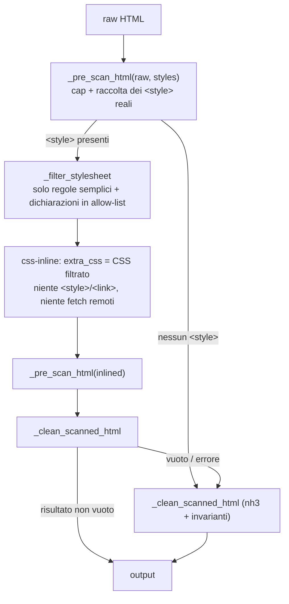

# Design — Fase 3 rendering HTML Gmail (inlining dei blocchi `<style>`)

Data: 2026-10-27 · Base: Fase 2 (`docs/DESIGN_GMAIL_HTML_PHASE2.md`).
Ambito: `server/gmail.py` (`sanitize_html`, scanner, budget CSS), dipendenza `css-inline`,
`tests/test_gmail_html_phase3.py`.

## 1. Motivazione

Le newsletter moderne (Mailchimp, Substack, notifiche SaaS) definiscono gran parte dello stile
in blocchi `<style>` con classi. La Fase 1 rimuove `<style>` e `class` (invariante CSP: in output
solo attributi `style=`), quindi queste email arrivavano senza la maggior parte dello stile.

## 2. Pipeline

- **`_filter_stylesheet`** (tinycss2): scarta at-rule (`@media`, `@import`, `@font-face`,
  `@supports`…), selettori stateful (`:hover`, `:focus`, `:active`, `:visited`, `:target`,
  `:checked`, pseudo-elementi `::`) uno per uno nelle liste di selettori, e ogni dichiarazione
  non in `_STYLE_VALIDATORS` o non valida. I valori sono già ri-serializzati dai validatori,
  `background` passa come `background-color` e `!important` viene conservato solo per
  risolvere la cascata (`_sanitize_style` lo rimuove). Limiti: CSS ≤ 64 KB
  (`_INLINE_CSS_MAX_CHARS`), regole ≤ 1000 (`_INLINE_CSS_MAX_RULES`).
- **`css-inline`** (Rust, MIT): `inline_style_tags=False` (usa solo il CSS filtrato),
  `load_remote_stylesheets=False`, `keep_style_tags/keep_link_tags/keep_at_rules=False`.
  Applica correttamente specificità e cascata; lo `style` inline esistente vince, salvo
  `!important`.
- **Il confine di sicurezza non cambia**: il documento inlined ripassa per scanner, nh3 e
  `_sanitize_style` come qualsiasi email. `_filter_stylesheet` serve a fedeltà e dimensioni,
  non alla sicurezza.
- **Fallback**: se l'inlining è disattivato, se `css-inline` manca, se solleva un'eccezione,
  se produce più di 1 MB o se il documento inlined supera un cap, si sanitizza il documento
  originale (comportamento della Fase 2).
- **Kill switch**: `GMAIL_HTML_INLINE_CSS=0` (anche `GMAIL_HTML_STYLES=0` disattiva l'inlining).

## 3. Budget CSS (cap rivisti)

L'inlining assegna uno `style` a quasi ogni elemento, quindi il cap di 400 attributi `style`
avrebbe fatto ricadere quasi ogni newsletter nel fallback.

| Cap | Prima | Ora |
|---|---|---|
| `_HTML_MAX_STYLE_ATTRS` | 400 | **2000** |
| `_HTML_MAX_STYLE_DECLS_TOTAL` (nuovo) | — | **12 800** (= 400 × 32) |

Il vero limite di lavoro diventa il **budget totale di dichiarazioni**: lo stesso lavoro
tinycss2 del vecchio caso peggiore (400 attributi × 32 dichiarazioni). Il conteggio
(`_style_declaration_count`) usa i segmenti non vuoti separati da `;` sul valore **decodificato
dalle entità** (quello che vede tinycss2). Il sanitizer può solo togliere dichiarazioni, quindi il
conteggio dell'output è ≤ quello dell'input: ogni output viene riaccettato e l'idempotenza
`sanitize_html(sanitize_html(x)) == sanitize_html(x)` resta valida. Lo `style` generato da
`<body>` (Fase 2) rientra nello stesso budget.

## 4. Limiti noti

- `@media` non è riprodotto: il reader è largo al più 720px, quindi va bene il layout desktop.
- Uno shorthand `background` con immagine viene scartato del tutto (anche il colore), come
  per lo `style` inline.
- Un `<style>` non chiuso viene ignorato dall'inlining.

## 5. Test

`tests/test_gmail_html_phase3.py`:
- inlining di classi, selettori figlio/discendente e della regola `body`;
- cascata e `!important`;
- rifiuto di at-rule, stateful e proprietà o funzioni pericolose;
- nessun accesso di rete con `<link>`;
- `<style>` dentro un commento ignorato;
- kill switch;
- fallback per modulo assente, eccezione e budget superato;
- limiti sulla dimensione del CSS e sul numero di regole;
- budget di dichiarazioni al confine e relativa idempotenza;
- tempo di una newsletter con 500 regole e 1200 righe.

Il caso P3 della Fase 1 è aggiornato al nuovo cap e copre anche il budget di dichiarazioni.
