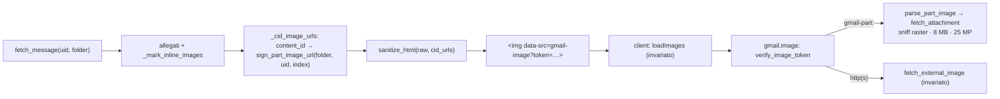

# Design — Fase 4 rendering HTML Gmail (immagini incorporate `cid:`)

Data: 2026-10-27 · Base: reader compatto (PR #292) e Fase 3.
Ambito: `server/gmail.py` (token `gmail-part:`, sanitizer, dettaglio), `server/ops/gmail.py`
(`gmail.image`), `tests/test_gmail_html_phase4.py`.

## 1. Motivazione

Firme, loghi e foto incollate (Outlook, Apple Mail) sono parti MIME `multipart/related`
richiamate dall'HTML con ``. Il sanitizer accettava solo http(s), `data:` e
token firmati, quindi queste immagini apparivano rotte. Il reader le elencava solo come
"immagini nel testo", grazie al flag `inline` della PR #292.

## 2. Flusso

- **Token**: lo stesso HMAC delle immagini remote (`sign_image_url`), con payload
  `gmail-part:<scadenza>:<uid>:<indice>:<cartella>`. Il client non cambia: `safeImageUrl`
  accetta già `gmail-image?token=…`.
- **Sanitizer**: `_filter_image_src` riscrive `cid:` (case-insensitive, URL-decoded,
  senza `<>`) solo se il chiamante ha passato la mappa `cid_urls`; altrimenti l'immagine viene
  scartata. `parse_message` (senza uid e cartella) non genera URL. L'idempotenza resta,
  perché alla seconda passata l'URL firmato segue il ramo già esistente dei token firmati.
- **Solo immagini citate**: la mappa contiene solo le parti con `inline: true`, cioè
  immagini referenziate con `cid:` dall'HTML (PR #292).

## 3. Sicurezza

| Rischio | Mitigazione |
|---|---|
| Token `gmail-part:` forgiato da un mittente | Firmato HMAC lato server; il sanitizer firma solo URL http(s) (`_safe_image_source`), quindi un `src="gmail-part:…"` nella mail viene scartato (test). |
| Accesso alla casella senza Bearer token (l'endpoint immagini non è autenticato) | Scadenza **24 h** (`_PART_IMAGE_TTL_S`). Le immagini remote invece non scadono: è un rischio già accettato. Il token è legato a uid, indice e cartella validata. |
| Parte non immagine (SVG/HTML con script) servita come immagine | Tipo **dedotto dai byte** (`_sniff_raster`: PNG/JPEG/GIF/WebP), mai dal Content-Type dichiarato; altrimenti 502. La risposta mantiene `nosniff`, `no-store` e la CSP `default-src 'none'` del proxy. |
| DoS / immagini enormi | Cap del proxy: 8 MB, 25 MP (dimensioni lette dall'header), semaforo 4, cap 50 immagini per messaggio nel client. |

## 4. Prefetch e cache

Nella prima versione ogni immagine incorporata richiedeva una sessione IMAP propria (select,
struttura, parte): **0,5–0,8 s** per immagine. Con il pool limitato a 4 connessioni, quattro
immagini in parallelo richiedevano **~11 s** e l'apertura della mail successiva passava da
~490 a ~940 ms (misurato su mail reali).

Ora le immagini candidate vengono scaricate **nello stesso `UID FETCH` delle parti di testo**,
quindi senza scambi aggiuntivi. Sono candidate (`_inline_image_candidates`, decise dalla sola
BODYSTRUCTURE) le parti con queste caratteristiche:
- `image/*` con Content-ID;
- non `attachment`;
- ≤ 2 MB ciascuna e ≤ 6 MB in tutto.

Dopo il parsing vengono messe in una cache in memoria solo quelle con `inline: true`:
- LRU da 32 MB, scadenza 1 h, chiave `(cartella, uid, indice)`;
- il percorso di fetch completo usa i byte già scaricati.

Il proxy legge prima dalla cache (`cached_inline_image`) e solo se manca, per esempio dopo un
riavvio o un'eviction, ripiega su `fetch_attachment`. Se il FETCH esteso fallisce, la mail
viene comunque scaricata senza le immagini.

Misure su mail reali (2 immagini):

| | Prima | Dopo |
|---|---|---|
| Apertura del messaggio, mediana | 513 ms | 580 ms |
| Ogni immagine dal proxy | 500–800 ms | 0–1 ms |
| 4 immagini in parallelo | ~11 s | 0,56 s |
| Mail successiva aperta durante il caricamento | ~940 ms | ~500 ms |

## 5. Limiti noti

- In caso di cache miss, `fetch_attachment` scarica la parte prima del controllo degli 8 MB
  (limite di download generale: 50 MB).
- Il gruppo "+ N immagini nel testo" resta nel pannello allegati per poterle salvare.

## 6. Test

`tests/test_gmail_html_phase4.py`:
- token: andata e ritorno, scadenza, payload malformati, nessuna firma per `src="gmail-part:…"`;
- riscrittura `cid:` e idempotenza, mappa mancante, `_parse_full` con e senza uid/cartella;
- proxy: PNG servito come `image/png` anche con Content-Type dichiarato generico;
- proxy: SVG/HTML/vuoto → 502, oltre 25 MP → 502, token scaduto → 404 senza IMAP,
  parte inesistente → 404.
