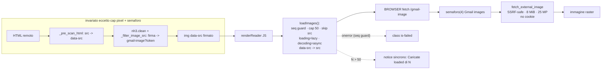

# DESIGN — Immagini Gmail visibili di default · rev. 1

Data: 2026-10-25 · Stato: design rev. 1 (integrazione red team) · nessuna implementazione, nessun commit
Richiesta utente: immagini visibili di default, bottone rimosso, tracking accettato.

## 0. Decisioni confermate (cap)

| Parametro | Valore | Dove |
|-----------|--------|------|
| Max immagini/messaggio | **50** | `web/static/gmail.js` (`MAX_IMAGES_PER_MESSAGE`) |
| Max pixel/immagine | **25 MP** (25 000 000) | `server/link_preview.py` (opt-in `max_pixels`) + `server/ops/gmail.py` (`gmail.image`) |
| Semaforo fetch Gmail | **4** concorrenti | `web/gmail_api.py` (`asyncio.Semaphore(4)` per router/app, non module-level) |
| Cache busting | `gmail.js?v=16` → **17** | `web/static/index.html:319` |

### 0.1 Riserve R1–R6 del secondo gate (recepite)

| Riserva | Recepimento |
|---|---|
| **R1** (B2 cancel) | `cancelPendingImages()` è la prima operazione di `closeReader`/`showReaderLoading`/`showReaderError` e l'inizio di `renderReader`, prima di `replaceChildren`/`textContent`; test di ordine/cancel a carico del tester. |
| **R2** (test proxy/parser) | I fake di `tests/test_gmail_image_proxy.py` vanno aggiornati per `max_pixels`; test 11 con `httpx2`; test unitari `_raster_dimensions` per PNG/JPEG/GIF/WebP e caso APP1 con SOF falso; test cancel/no-JS/orfani. Non in questa modifica (tester). |
| **R3** (semaforo) | `asyncio.Semaphore(4)` creato dentro `create_gmail_image_router()` (per router/app/loop), non a livello di modulo; multi-worker documentato. |
| **R4** (JPEG) | Parser segment-aware: SOI, lunghezze dei segmenti, skip APPn/COM, primo SOF reale; niente SOF da thumbnail APP1. |
| **R5** (budget aggregato) | Rischio documentato: 50 × 25 MP = 1,25 Gpixel (~5 GB RGBA) e 50 × 8 MiB = 400 MB per messaggio; il semaforo limita la concorrenza, non il totale. Nessun budget aggregato implementato in rev. 1. |
| **R6** (docs/minori) | Sezioni README/POC enumerate in §8; notice cap basato su `loaded`; `httpx2`; test orfani/no-JS a carico del tester. |

---

## 1. Tabella risoluzione blocker/major

| Id | Tema | Risoluzione |
|----|------|-------------|
| B1 | Notice errori | **Niente notice per errori** (solo `.is-failed`). Notice **sincrono** solo per il cap: `Caricate ${loaded} di ${images.length} immagini.` (M4) |
| B2 | Generation/cancel | `loadImages()` cattura `state.readerSeq`; callback `error` con guard; `cancelPendingImages()` come **prima istruzione** di close/loading/error e all'inizio di `renderReader`, prima di `replaceChildren`/`textContent`; skip se `src` già presente; toggle Testo→HTML ri-pinga (documentato) |
| B3 | DoS | cap 50 JS + pixel cap 25 MP proxy (parser segment-aware) + semaforo 4 + lazy/decoding prima di `src`; rischi residui documentati (token replay, no-store, re-ping, budget aggregato) |
| B4 | Cache busting | bump `gmail.js?v=16` → `17` + test statico |
| M1 | Test Node DOM stub | nuovo `tests/test_gmail_images_default.py` (casi in §7); fake proxy esistenti da aggiornare per `max_pixels` |
| M2 | Docs/commenti | README, `DESIGN_GMAIL_POC.md` (sezioni §Gmail, D7, §5.2, rischi), commento `server/gmail.py`, docstring `sanitize_html` |
| M3 | Privacy completa | IP server, timing, no-store, toggle re-ping, chiusura, header outbound, token replay/endpoint non-auth, budget aggregato (§6) |
| M4 | Semantica notice | decisa in B1 |
| M5 | Contract token | test Python→JS (`sign_image_url` ↔ regex `safeImageUrl`) |

---

## 2. Decisione 1 — meccanismo di load (invariata dalla rev. 0)

**Mantenere `data-src` + auto-copy a `src` in JS.** Non emettere `src` lato server.

Motivo (bloccante per l'alternativa): `sanitize_html` usa `nh3.clean(..., url_relative="deny")` (`server/gmail.py:2932`). Il path firmato (`gmail-image?token=...`, page-relative) verrebbe strippato se fosse `src`; `data-src` non è un attributo-URL per nh3, quindi sopravvive. Emettere `src` richiederebbe di toccare `_ALLOWED_HTML_ATTRIBUTES["img"]`, `_render_img_tag`, `_pre_scan_html`, `_filter_image_src` e/o rilassare `url_relative` (vettore open-redirect/XSS-adjacent). Il `data-src` resta un gate inerte: il browser non fetcha finché il JS non setta `src`.

Il server emette ancora `img[data-src="gmail-image?token=…"]`: il path sanitizer/signing resta **invariato**.

---

## 3. Flusso (rev. 1)



---

## 4. Modifiche per file

### `web/static/gmail.js`
- **`elements`**: rimuovere `imagesToggle: document.getElementById("gmail-images-toggle"),`.
- **`state`**: rimuovere `imagesLoaded: false,`.
- **Top-level**: aggiungere `const MAX_IMAGES_PER_MESSAGE = 50;` (sliceabile nei test Node).
- **`cancelPendingImages()`**: rimuove `src` dalle `img` del reader; chiamarla come **prima istruzione** di `closeReader`/`showReaderLoading`/`showReaderError` (quindi prima di `replaceChildren`/`textContent`) e all'inizio di `renderReader`.
- **Sostituire `toggleImages()`** con:
  ```js
  function cancelPendingImages() {
    for (const image of elements.readerBody.querySelectorAll("img")) {
      image.removeAttribute("src");           // annulla fetch pendenti
    }
  }

  function loadImages() {
    const seq = state.readerSeq;              // generation guard
    const images = [...elements.readerBody.querySelectorAll("img[data-src]")];
    let loaded = 0;
    for (const image of images) {
      if (loaded >= MAX_IMAGES_PER_MESSAGE) break;
      if (image.hasAttribute("src")) continue; // idempotente / skip doppio set
      const url = safeImageUrl(image.dataset.src || "");
      if (!url) { image.classList.add("is-failed"); continue; }
      image.loading = "lazy";                  // PRIMA di src
      image.decoding = "async";                // PRIMA di src
      image.addEventListener("error", () => {
        if (state.readerSeq !== seq) return;   // generation stale
        image.classList.add("is-failed");
      }, { once: true });
      image.src = url;
      loaded += 1;
    }
    if (images.length > MAX_IMAGES_PER_MESSAGE) {
      showNotice(`Caricate ${loaded} di ${images.length} immagini.`);
    }
  }
  ```
- **`renderReader`**: sostituire il blocco `state.imagesLoaded = false; ...` con `if (mode === "html") loadImages();` a fine ramo HTML.
- **Listener**: rimuovere `elements.imagesToggle.addEventListener("click", toggleImages);`.
- **`safeImageUrl`**: invariato.

### `web/static/index.html`
- Rimuovere `<button id="gmail-images-toggle" ...>Mostra immagini</button>` dalla toolbar del reader.
- `gmail.js?v=16` → `gmail.js?v=17` (ora riga 319).

### `web/static/gmail.css`
- **Righe 479, 484**: **nessuna modifica**. `img[data-src]:not([src])` = placeholder no-JS / immagini oltre il cap (restano `data-src` senza `src`); `.is-failed` = errore. CSS resta `?v=17` (riga 15).

### `server/link_preview.py`
- Aggiungere helper best-effort dimensioni raster (fail-open: se non parseable → consenti; backstop = byte cap):
  ```py
  def _raster_dimensions(data: bytes, content_type: str) -> tuple[int, int] | None:
      """(width, height) from header; None if unparseable (best-effort)."""
      # PNG  : IHDR @16, width/height u32 BE
      # JPEG : segmenti con lunghezza; skip APPn/COM; primo SOF reale
      # GIF  : @6, width/height u16 LE
      # WebP : VP8X canvas 24-bit LE +1 / VP8L 14-bit / VP8 frame 14-bit
  ```
  Il parser JPEG è **segment-aware**: niente falsi SOF dentro thumbnail APP1/EXIF.
- **`fetch_external_image`**: aggiungere `max_pixels: int | None = None`; dopo `_sniff_raster`, se `max_pixels` e `_raster_dimensions` restituisce `(w,h)` con `w*h > max_pixels` → `return None` (→ 502). Default `None` = nessun pixel cap → **link preview invariate**; dimensioni ignote = fail-open documentato (backstop = byte cap).

### `web/gmail_api.py`
- Aggiungere `_GMAIL_IMAGE_MAX_PIXELS = 25_000_000` e `_GMAIL_IMAGE_CONCURRENCY = 4`.
- In `create_gmail_image_router()` creare `asyncio.Semaphore(_GMAIL_IMAGE_CONCURRENCY)` **per router/app/loop** (non module-level, così un restart del web server non riusa un semaforo legato al vecchio loop).
- **Rotta `/gmail-image`**: il router resta thin e chiama l'operazione `gmail.image` (che verifica il token e fa il fetch), avvolta nel semaforo:
  ```py
  async with image_semaphore:
      blob = await call_op(request, "gmail.image", {"token": token})
  ```
  Il fetch vero e proprio (resolver SSRF-safe, sniff raster, byte/pixel cap) vive in `server/ops/gmail.py`, che passa `max_pixels` a `server/link_preview.py`.
- Il semaforo limita la **concorrenza applicativa** delle immagini Gmail a 4, ortogonale al `TCPConnector(limit=8)` della sessione condivisa (`server/link_preview.py:44`) che resta condiviso con le link preview. Con N worker uvicorn la concorrenza aggregata è 4×N.

### `server/gmail.py` (solo commenti/docstring, zero logica)
- **Righe 93–96**: aggiornare "Remote images are not loaded (tracking pixels)" → "Remote images are rewritten to signed same-origin proxy URLs and loaded by default in the client (user accepted tracking)".
- **Docstring `sanitize_html` (2896–2905)**: "remote images are dropped on purpose to avoid tracking pixels" → riflettere il nuovo comportamento (deferiti a `data-src` firmato, caricati dal client).

---

## 5. Semantica notice (B1/M4)

- **Errori immagine**: nessun notice; solo `.is-failed` sul nodo (con generation guard). Niente timer (il bug del `failed===0` al check sincrono è eliminato per costruzione).
- **Cap**: notice **sincrono**, emesso nella stessa esecuzione di `renderReader`, quindi immune a race. Testo: `Caricate ${loaded} di ${images.length} immagini.` — `loaded` è il conteggio reale, non il cap teorico.

---

## 6. Privacy (M3)

- **IP client**: mai esposto al mittente — fetch server-side via proxy.
- **IP server**: visibile al mittente.
- **Timing**: il mittente vede il fetch all'apertura del messaggio.
- **`Cache-Control: no-store`** (`gmail_api.py:87`): ogni render ri-fetcha → ogni apertura ri-pinga il tracker. Accettato.
- **Toggle Testo→HTML**: `toggleRenderMode` → `renderReader` → nuovo `loadImages` → **ri-pinga**. Documentato e accettato. (Mitigazione opzionale futura, NON in rev. 1: cache per-messaggio `url → loaded` per evitare re-ping; esclusa per minimalità.)
- **Chiusura/cambio messaggio/toggle**: `cancelPendingImages()` rimuove `src` e abbatte i fetch in-flight; è chiamata **prima** di `replaceChildren`/`textContent` in `closeReader`/`showReaderLoading`/`showReaderError` e all'inizio di `renderReader`.
- **Budget aggregato**: 50 immagini × 25 MP = 1,25 Gpixel (circa 5 GB di RGBA decodificato) e 50 × 8 MiB = 400 MB di payload per messaggio. Il semaforo 4 limita la concorrenza, non il totale: **nessun budget aggregato implementato in rev. 1**; rischio residuo accettato e documentato.
- **Header outbound** (`server/link_preview.py:241-252`): User-Agent `MegachatLinkPreview/1.0`, `Accept-Language`, `DummyCookieJar` (nessun cookie client), `trust_env=False`, redirect validati manualmente. Nessun header/cookie client forwardato.
- **Token replay / endpoint non-auth**: `/gmail-image` è montato fuori dal middleware Bearer (`server.py:126`, `auth.py:44` protegge solo `/api/`). Il token è HMAC-firmato (non forgiabile) ma **non scade** e **non è single-use**: chiunque ottenga l'URL (log, history, referrer se futuro) può ri-fetchare l'immagine. Accettato; mitigazione fuori scope (TTL corto/one-time romperebbe lazy/re-render).

---

## 7. Test (M1/M5)

Nuovo file `tests/test_gmail_images_default.py` (pattern `vm.runInThisContext` + `node -e` come `test_web_avatar.py`, version bump come `test_web_media_version.py`). Slice di `safeImageUrl` + `loadImages` (e `MAX_IMAGES_PER_MESSAGE`) con DOM stub:

1. `safeImageUrl`: accept `gmail-image?token=…` (e la forma legacy `/gmail-image?...`), `data:image/png;base64,…`; reject `javascript:`, `https://`, `../`, stringa vuota.
2. `loadImages`: `loading`/`decoding` settati **prima** di `src` (DOM stub che registra l'ordine).
3. `loadImages`: con 60 `` → 50 con `src`, 10 senza, notice `Caricate 50 di 60 immagini.`.
4. `loadImages`: URL invalido → **nessun** `src`, classe `is-failed`.
5. `loadImages`: `error` → `is-failed`; **nessun notice** per errori.
6. Generation: doppio render / `readerSeq` incrementato durante load → callback stale **non** aggiunge `is-failed` al DOM corrente, nessun notice stale.
7. Skip doppio set: nodo con `src` già presente non viene riassegnato.
8. Contract token Python→JS: `gmail.sign_image_url("https://x/y.png")` matcha la regex di `safeImageUrl` (e `verify_image_token` round-trip).
9. `index.html`: assenza `gmail-images-toggle`; presenza `gmail.js?v=17`; assenza in `gmail.js` di `imagesToggle`/`imagesLoaded`/`toggleImages`.
10. Proxy: test unitari `_raster_dimensions` per PNG/JPEG/GIF/WebP (incluso APP1 con SOF falso) + header craftati oltre 25 MP → `502`, sotto soglia → `200`.
11. Concorrenza semaforo: `httpx2.AsyncClient` + `ASGITransport`, 10 richieste parallele con fake `fetch_external_image` che traccia `active`/`max_active` → `max_active <= 4`; test anche con due loop sequenziali (restart).
12. Cancel: `cancelPendingImages()` rimuove `src` **prima** di `replaceChildren`/`textContent` e in `renderReader`.
13. No-JS: HTML server senza `src`, placeholder CSS; reader JS-driven.

`test_gmail_html.py` e `test_gmail_html_phase1.py` restano invariati. `test_gmail_image_proxy.py` va aggiornato: i fake `(url, max_bytes)` devono accettare `max_pixels` (il tester; non in questa modifica).

---

## 8. Docs (M2)

- `README.md` sezione Gmail (riga ~720): rimuovere “Mostra immagini”/“not loaded automatically”, documentare proxy di default, IP server/timing, `no-store`, re-ping toggle, cap 50/25 MP, semaforo, budget aggregato e rischi residui.
- `docs/DESIGN_GMAIL_POC.md`: D7 (~53), §5.2 lettore (~148), tabella test (~167-168), rischi (~197), criteri (~215).
- Commenti `server/gmail.py` (§4) e docstring `sanitize_html`.

---

## 9. Rollback

- Revert di `index.html` + `gmail.js` + `web/gmail_api.py` + `server/ops/gmail.py` + `server/link_preview.py` (feature flag assente, revert manuale). Ripristino del bottone + `toggleImages()` + `imagesLoaded`. Nessuna migrazione/schema/dipendenza.

---

## 10. Rischi residui (2° gate red team)

1. **Token replay**: endpoint non-auth + token senza scadenza → URL condiviso = immagine ri-fetchabile. Mitigazione futura: TTL/one-time (trade-off con lazy/re-render).
2. **Re-ping no-store + toggle**: ogni apertura e ogni toggle Testo→HTML ri-pinga. Accettato dall'utente.
3. **Cap 50 è soft e lato client**: un client malevolo/modificato può aggirarlo; è una difesa UX/DoS, non di sicurezza. Il backstop server restano 8 MiB/img + semaforo 4 + pixel cap 25 MP.
4. **Pixel cap fail-open**: se le dimensioni non sono parseabili, si consente (backstop = 8 MiB). Decompression bomb con header compatto e body compresso resta limitato solo dai byte. Il parser JPEG è segment-aware (skip APPn/COM, primo SOF reale) per evitare falsi SOF da thumbnail APP1; header malformati restano fail-open.
5. **`loading="lazy"` è hint** non garanzia: browser non-lazy caricano eager → N fetch simultanei, mitigati dal semaforo 4.
6. **Semaforo 4 per router/app/loop** (creato in `create_gmail_image_router()`, non module-level): corretto su singolo worker uvicorn e dopo restart; con worker multipli la concorrenza totale è 4×worker. Documentato nel commento.
7. **`data-src`+`src` coesistenti**: dopo il copy restano entrambi; `data-src` inerte (nessun doppio fetch). Non rimuovere `data-src` (serve a `safeImageUrl`).
8. **No-JS**: immagini non caricano (placeholder grigio). Reader già JS-driven.
9. **Budget aggregato**: 50 immagini × 25 MP ≈ 1,25 Gpixel (~5 GB RGBA) e 50 × 8 MiB = 400 MB di payload per messaggio. Il semaforo limita solo la concorrenza; nessun budget totale in rev. 1. Documentato come rischio accettato; mitigazione futura: abbassare i cap o introdurre un budget per messaggio.

---

## 11. Ordine di implementazione

1. `server/link_preview.py` → `_raster_dimensions` + `max_pixels` (test 10).
2. `web/gmail_api.py` → semaforo 4 per router/app; `server/ops/gmail.py` → pixel cap (test 11).
3. `gmail.js` → `MAX_IMAGES_PER_MESSAGE`, `cancelPendingImages`, `loadImages`, rimozione toggle/state, hook `renderReader` (test 1–7).
4. `index.html` → rimozione bottone + `?v=17` (test 9).
5. Commenti/docs `server/gmail.py`, README, POC (M2).
6. Contract token Python→JS (test 8).
7. Verifica live manuale (immagini caricate, cap, errore, lazy, toggle ri-ping).
