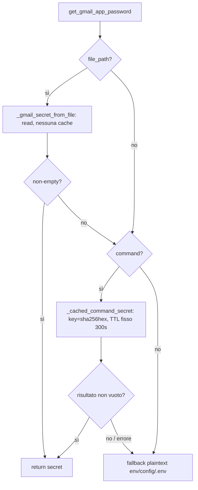
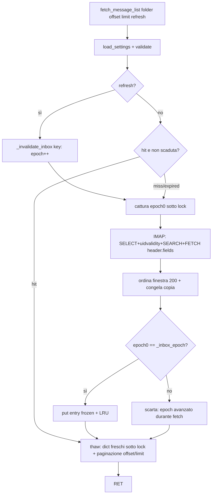

# Design — Ottimizzazioni P0+P1 Gmail (request latency)

> **Nota (mc-im6):** il servizio Gmail descritto qui come `web/gmail.py` ora vive in
> `server/gmail.py` (core) e le sue funzioni sono esposte come operazioni `gmail.*`
> (`server/ops/gmail.py`); `web/gmail_api.py` si limita a tradurle in HTTP. I percorsi
> `web/gmail.py` e i numeri di riga qui sotto descrivono il codice com'era al momento
> del design. Vedi `docs/DESIGN_CLIENT_SERVER_SPLIT.md` §13.

Data: 2026-10-23 · Branch: `perf/gmail-request-latency` · Stato: proposta (rev. 5, post-red-team round 4) · Ambito: solo Gmail (`protocols/config.py`, `web/gmail.py`, `web/gmail_api.py`, `web/static/gmail.js`, test Gmail).

> **Revisione 5** — de-scope della configurabilità TTL e della semantica **TTL 0** (elimina **R1/R2**): TTL **fissi** segreto **300s** / lista inbox **15s**, niente `GMAIL_SECRET_CACHE_TTL_S`/`GMAIL_LIST_CACHE_TTL_S`. Le misure cold usano `clear_gmail_secret_cache()`/`clear_inbox_cache()` tra le iterazioni, non un TTL 0. **R3 logging**: mai `argv`/`argv[0]`/`basename`/`str(exc)`; solo `type(exc).__name__`, `errno`, `timeout`, `returncode` e **label fissa**. Recepite inoltre: dedup flags `tuple(sorted(set(...)))`, **deep-freeze** (mutare un dict restituito da hit non altera la cache), **delete singolo/bulk invalidano globalmente** la lista (try/finally anche su COPY/STORE/EXPUNGE parziale), **`mark_read` aggiorna solo la chiave corrente** (cross-folder TTL documentato), ramo errore comando → **fallback plaintext** (mermaid), correzione `uidvalidity`. Vedi §10 per il riepilogo puntuale.

---

## 1. Obiettivi e non-obiettivi

**Obiettivi**
- **P0** — eliminare il `systemd-creds decrypt` (TPM unseal ~0,76s) a ogni richiesta via cache in-memory del **solo output del comando** (TPM/GPG).
- **P1a** — ridurre il payload della lista sostituendo `BODY.PEEK[HEADER]` con `BODY.PEEK[HEADER.FIELDS (...)]`.
- **P1b** — cache server-side della finestra inbox (200 summary) con TTL breve e snapshot immutabili; `mark_read` aggiorna la cache **in-place** (hit, non miss).

**Non-obiettivi**
- Nessun cambio al contratto REST/UX per le chiamate normali. **Unica aggiunta additiva**: parametro `refresh` (bool/0/1) su `GET /api/gmail/messages` (§5).
- Nessuna modifica a WhatsApp/Signal/Telegram.
- Nessuna nuova dipendenza runtime; nessun DB/cache persistente.
- Non si tocca `UID SEARCH ALL` (0,42s): resta nel percorso di miss.
- **Nessun retry automatico su auth failure** (de-scoped, §9.2).
- **Nessun TTL configurabile, nessuna semantica TTL 0**: i TTL sono costanti fisse (rev. 5, §2.1/§4.1).

**Baseline misurata, ricalibrata aritmeticamente** (i componenti sono già rilevati; la somma precedente "3,3–4,0s" era sbagliata):

| Componente | Costo | Note |
|---|---|---|
| `UID SEARCH ALL` | 0,42s | invariato, solo percorso di miss |
| `FETCH BODY.PEEK[HEADER]` (full) | 1,37s | 1,1 MB; bersaglio di P1a |
| TPM decrypt (`systemd-creds`) | 0,76s | bersaglio di P0, una tantum dopo warm |
| connect TLS + `SELECT` + `UIDVALIDITY` + parse/sort | ~0,3–0,6s | stimato, da misurare |

⇒ **cold totale attuale ≈ 0,42 + 1,37 + 0,76 + (0,3–0,6) ≈ 2,9–3,2s** (non 3,3–4,0s). `/api/gmail/status` cold ≈ 0,76s = solo decrypt TPM.

---

## 2. P0 — cache del segreto Gmail (solo output comando)

**File**: `protocols/config.py`. Cache in-memory della stringa risolta **solo per la sorgente `GMAIL_APP_PASSWORD_CMD`** (decrypt TPM/GPG).

**B1 — perché non si cacha la sorgente file.** Leggere un file di pochi byte è sub-ms: nessun guadagno. La cache del file introdurrebbe rischi senza beneficio:
- **TOCTOU / same-size-same-mtime**: `stat` non rileva una riscrittura in-place che mantiene size e mtime ⇒ si servirebbe un segreto vecchio.
- **Ritenzione di segreti storici**: il valore resterebbe in RAM dopo la rotazione.
- **Nessun guadagno**: il costo è dominato da `read_text`.

Quindi `_gmail_secret_from_file` è invocato a ogni chiamata, senza cache. Restano senza cache anche `env`/`config.json`/`.env` (plaintext, sub-ms).



> Il ramo comando, in caso di **errore** (quote malformate, OSError, timeout, returncode≠0, stdout vuoto, decode error), **non ritorna direttamente** ma **ricade sul plaintext** `env`/`config.json`/`.env` (stessa catena file→comando→plaintext già esistente).

### 2.1 Cache key, TTL e invalidazione

| Sorgente | Cache key | TTL | Invalidazione |
|---|---|---|---|
| file | *nessuna cache* | — | rilettura a ogni chiamata (sub-ms, nessun TOCTOU) |
| comando (TPM/GPG) | `sha256(command).hexdigest()` **str** | **fisso 300s** (`monotonic`, costante `_GMAIL_SECRET_CACHE_TTL_S = 300`) | scadenza TTL ⇒ riesegue; `clear_gmail_secret_cache()` ⇒ gen++ e vuota |
| plaintext (env/config/.env) | *nessuna cache* | — | già economico (sub-ms) |

**B2 — tipo di chiave coerente.** La chiave è **sempre** `hashlib.sha256(command.encode("utf-8")).hexdigest()` → una `str` esadecimale. **Nessuna** tupla `("cmd", sha256)`: ovunque (tabella, stato, helper) il tipo è `dict[str, tuple[float, str]]`. La chiave è opaca e non loggabile; il comando raw non compare mai in chiavi né log (il comando può contenere un segreto inline, es. `gpg --decrypt --passphrase X`).

**Solo output non vuoto e comando riuscito.** Si cacha solo quando `returncode == 0` **e** `stdout.strip()` non è vuoto. Fallimenti, timeout e output vuoto **non** vengono cachati: ricadono sul plaintext (§2 mermaid) e riprovano al call successivo.

**TTL fisso, non configurabile (rev. 5).** Nessun getter, nessuna env var: il TTL è la costante `_GMAIL_SECRET_CACHE_TTL_S = 300`. **Non esiste** una semantica "TTL 0 = disabilita": per forzare un miss freddo (test/misure) si usa **`clear_gmail_secret_cache()`**, che vuota la cache e incrementa la generation sotto lock. Questa rimozione elimina **R1/R2** alla radice: non c'è alcun percorso in cui la cache "non legga/scrivano" o "rimuova entry calde" in base a un parametro runtime.

### 2.2 Struttura e thread-safety

- Stato: `_gmail_secret_cache: dict[str, tuple[float, str]]` (sha256 → `(expires_at_monotonic, secret)`) + `_gmail_secret_cache_gen: int` + `_gmail_secret_cache_lock: threading.Lock`.
- `threading.Lock` usata **solo** per get/put/gen++/prune (operazioni ~ns). Il `subprocess` avviene **fuori** dalla lock (double-checked lookup).
- **Generation anti-overwrite**: il miss cattura **`gen0 = _gmail_secret_cache_gen` sotto lock** prima di lanciare il comando; il put finale avviene **solo se `_gmail_secret_cache_gen == gen0`** (check+put nella stessa sezione critica). Così un decrypt in-flight partito prima di `clear_gmail_secret_cache()` non ripopola la cache. `clear_gmail_secret_cache()` fa `cache.clear()` e `gen += 1` sotto lock.
- **Prune delle scadute (evita accumulo di segreti storici)**: su get e put, le entry con `expires_at <= now` vengono rimosse sotto lock. Con un solo `GMAIL_APP_PASSWORD_CMD` configurato resta **una sola entry viva**; un cambio di comando a runtime produce una nuova chiave e la vecchia entry scade/pruned (mai ritenuta oltre il TTL).
- **Due miss concorrenti ⇒ duplicazione del decrypt accettabile.** Single-user, finestra minuscola. **Last-writer documentato come rischio accettato**: i due put scrivono **lo stesso valore** (stesso comando ⇒ stesso output stabile del credential helper), quindi l'ordine di scrittura è irrilevante; la generation copre solo il caso "clear nel mezzo". **Saturazione threadpool/TPM documentata**: in un burst di miss non cachati tutti lanciano un decrypt in parallelo; la finestra è limitata dalla concorrenza di `asyncio.to_thread` e dal TPM (che serializza gli unseal). La cache mantiene al più una entry viva (un solo `GMAIL_APP_PASSWORD_CMD`); eventuali entry residue sono pruned alla scadenza.

### 2.3 Logging sanitizzato (R3, rev. 5)

`_gmail_secret_from_command` viene riscritto così:

1. **`argv = shlex.split(command)` una sola volta, in un blocco protetto**:
   - su `ValueError` (quote malformate) logga **solo** `type(exc).__name__` + label fissa e ritorna `""` (⇒ fallback plaintext).
   - **guardia `if not argv`** subito dopo lo split: comando vuoto/solo-whitespace ⇒ log label fissa `"<empty>"` e ritorna `""` **prima** di qualunque `subprocess`.
2. I gestori successivi **non ri-splittano** e **non accedono mai a `argv`/`argv[0]`/`basename`** (rev. 5: rimosso anche `basename(argv[0])`, perché nel caso "comando = segreto nudo" il basename **è** il segreto).
3. `subprocess.run(argv, ...)` in un blocco che intercetta:
   - `subprocess.TimeoutExpired` → log `type(exc).__name__`, `exc.timeout`, label fissa; **mai `exc.cmd`/argv/`str(exc)`**; ritorna `""`.
   - `OSError` (include `FileNotFoundError`) → log `type(exc).__name__`, `exc.errno`, label fissa; **mai `exc.filename`/argv**; ritorna `""`.
   - `ValueError` (es. byte NUL in argv, argomento non valido) → log **solo** `type(exc).__name__`; ritorna `""`.
   - `UnicodeDecodeError` (stdout non-UTF8) → log **solo** `type(exc).__name__`; ritorna `""`.
4. `returncode != 0` → log `returncode` + label fissa; ritorna `""`.
5. `stdout.strip()` vuoto → log label fissa; ritorna `""`.

**Regola vincolante (R3)**: **mai** `argv`/`argv[0]`/`basename(...)`/`str(exc)`/`exc.cmd`/`exc.filename`, **mai** log di stdout/cache key/valore risolto. L'unico contenuto variabile ammesso nei log è `type(exc).__name__`, `errno`, `timeout`, `returncode`, più una **label fissa** (`"gmail_secret_cmd"`) che identifica l'operazione senza rivelare il comando. `GmailSettings.password` resta `repr=False`. **Estesa anche a `_gmail_secret_from_file`**: su `OSError`/`UnicodeDecodeError` di lettura si logga **solo** `type(exc).__name__` (e, per `OSError`, `errno`), **mai** `exc.filename`/path/`str(exc)`/contenuto del file. Test con `caplog` (§7.1), incluso il caso **comando = segreto nudo** (`"hunter2"`).

### 2.4 Chi ne beneficia

`gmail_enabled()` → `status_snapshot()` (status warm <50ms **solo entro TTL**); `load_settings()` → `imap_connect`/`smtp_connect`, `fetch_message_list`, `_fetch_one`, `mark_read`, `delete_*`, `send_email`. Nessun cambio di firma.

---

## 3. P1a — header fields nella lista

**File**: `web/gmail.py`, riga 922. Da:

```
(FLAGS BODY.PEEK[HEADER])
```

a:

```
(FLAGS BODY.PEEK[HEADER.FIELDS (FROM TO SUBJECT DATE CONTENT-TYPE CONTENT-DISPOSITION)])
```

- Campi richiesti da `parse_summary`: `From`, `To`, `Subject`, `Date`, più `Content-Type` per `_has_attachment_hint` (prima clausola `multipart/mixed|related`).
- `CONTENT-DISPOSITION` incluso per `get_content_disposition()=="attachment"` (raro single-part `attachment` senza filename). Il parametro `name=` **non** c'entra con `CONTENT-DISPOSITION`: `name=` sta in **`Content-Type`** (già incluso) ed è letto da `get_filename()`, che usa anche il `filename=` di `Content-Disposition`. Senza `CONTENT-DISPOSITION` si perderebbe solo il caso `get_content_disposition()=="attachment"`; costo di un nome header, trascurabile.
- **UID/FLAGS**: con `HEADER.FIELDS` il **literal** contiene **solo** gli header richiesti (niente `UID <n>` né `FLAGS (...)`). `UID` e `FLAGS` sono estratti esclusivamente dal **meta** (prefisso `b'<seq> (UID <n> FLAGS (...)...)'`). `_parse_fetch_data` è già corretto (UID/FLAGS dal meta, `raw`=literal). Nessuna modifica a `_parse_fetch_data`.
- **Compatibilità**: Gmail supporta `HEADER.FIELDS` (RFC 3501). Header mancanti ⇒ `message.get(...)` → `None` ⇒ `decode_mime_header(None)==""`, `_date_to_ts(None)=None`, `_has_attachment_hint` → `False`. `parse_summary` **invariato**.
- **Test differenziale**: per ogni messaggio del fake, `parse_summary(full_bytes) == parse_summary(filtered_header_bytes)`.
- Riduzione attesa >70% (1,1 MB → ~100–150 KB): si eliminano `Received`, DKIM/ARC, `List-*`, ecc. **Misurata su byte reali del FETCH**, non stimata.

---

## 4. P1b — cache finestra inbox (epoch globale)

**File**: `web/gmail.py`. Cache server-side in-memory della **finestra ordinata** (max 200 summary, ordinati per data desc), per folder+account.

### 4.1 Struttura, chiave e entry immutabile

- **Entry immutabile — dataclass `frozen`, non dict mutabile**:

  ```python
  @dataclass(frozen=True)
  class _InboxCacheEntry:
      uidvalidity: int
      messages: tuple[dict, ...]   # ogni summary ha "flags" congelato a tuple
      expires_at: float            # monotonic
  ```

- **Chiave (B3)** = `(folder_value, account_fingerprint)` dove `account_fingerprint = sha256(f"{address}\0{imap_host}\0{imap_port}")` (hex `str`). Un cambio `GMAIL_ADDRESS`/`GMAIL_IMAP_HOST`/`GMAIL_IMAP_PORT` a runtime produce un fingerprint diverso ⇒ **mai** servire messaggi del vecchio account. Chiave opaca (hash): nessuna PII in chiavi/log.
- **TTL fisso, non configurabile (rev. 5)**: costante `_GMAIL_LIST_CACHE_TTL_S = 15`. Nessuna env var, nessun getter, **nessuna semantica TTL 0**. Per forzare un miss freddo si usa **`clear_inbox_cache()`** (epoch++ + `clear()`), non un TTL 0. Elimina R1/R2 per la lista.
- **Limite/LRU**: `_INBOX_CACHE_MAX_ENTRIES = 16` cartelle. `collections.OrderedDict[key, _InboxCacheEntry]` con `move_to_end(key)` su hit e su put; oltre il tetto si evicta il meno recente (`popitem(last=False)`). **La LRU non tocca l'epoch globale** (non c'è alcun `clear()` dell'epoch): evictare una entry non invalida i fetch in-flight.

### 4.2 Epoch globale e atomicità (B4)

- Stato: `_inbox_cache: OrderedDict[key, _InboxCacheEntry]`, **`_inbox_epoch: int` (globale, non per-chiave)**, `_inbox_cache_lock: threading.Lock`.
- **Snapshot immutabili, nessun oggetto condiviso tra cache e risposta (deep-freeze)**:
  - **Put**: ogni summary viene congelato (`flags` → `tuple` canonico) in un dict nuovo; mai lo stesso oggetto del fetch. La entry è una `_InboxCacheEntry` frozen.
  - **Hit**: restituisce **dict freschi sotto lock** (thaw: `flags` → `list`), così la serializzazione JSON non condivide nulla con la cache. **Test dedicato (§7.3): mutare un dict restituito da un hit NON altera la cache** (deep-freeze).
- **Epoch globale**:
  - `_inbox_epoch` parte da `0`; si incrementa (`+= 1`) **sotto lock** su: delete (globale), `send_email`, `clear_inbox_cache`, e `mark_read` (su **ogni** `STORE \Seen` riuscito, **senza eccezioni**, §4.3).
  - Un **miss cattura `epoch0 = _inbox_epoch`** (sotto lock) **prima** del fetch IMAP.
  - Il **put finale avviene solo se `_inbox_epoch == epoch0`** (check+put nella stessa sezione critica). Questo scarta i fetch in-flight partiti prima di un delete/mark_read/send_email/clear.
  - **La LRU non modifica l'epoch**: evictare una entry per capienza non invalida nulla. (Nessuna contraddizione "persiste dopo eviction": non esiste più alcuna mappa per-chiave.)
  - `clear_inbox_cache()` (test/teardown): `_inbox_epoch += 1` + `_inbox_cache.clear()`.
  - `_invalidate_inbox(folder_value)` (per-key, usato **solo** da `refresh=1`): `_inbox_epoch += 1` + `pop(key, None)`.
  - `send_email` (successo): `_inbox_epoch += 1` + `_inbox_cache.clear()`.

### 4.3 Invalidazione e `mark_read` in-place

Scelta esplicita (rev. 3–4, precisata in rev. 5): **`mark_read` NON rimuove la entry**; **incrementa sempre l'epoch** (§4.2) e, se il target è presente e non già `seen`, la **sostituisce aggiornando solo la chiave corrente**. La lista successiva è un **hit** (non un miss) con `seen=True`.

| Evento | Azione |
|---|---|
| `delete_message` / `delete_messages` | **globale**: `_inbox_epoch += 1` + `_inbox_cache.clear()` — il delete cambia membership/ordine (COPY→STORE→EXPUNGE); un update parziale è fragile. Eseguita in **`try/finally`**: anche se COPY/STORE/EXPUNGE fallisce a metà, la cache viene comunque invalidata (correttezza). |
| `send_email` (successo) | `_inbox_epoch += 1` + `_inbox_cache.clear()` — la mail va in Sent/archivio, non sappiamo quale folder è cachato. |
| `mark_read` (successo) | **epoch++ sempre** + eventuale **update in-place della sola chiave corrente** (sotto lock) aggiornando **solo** il target se presente e non già `seen`. |

**Algoritmo `mark_read` cache update** (dopo il successo IMAP `STORE \Seen`):

1. **`_inbox_epoch += 1` SEMPRE, sotto lock** — ogni `STORE \Seen` riuscito invalida i fetch in-flight, **anche se** l'entry è `None` o l'UID non è nella finestra. Motivo: un `list` in-flight (flags `seen=false`) partito prima dello STORE completerebbe il put con epoch invariato e ripopolerebbe una entry stantia `seen=false`; l'avanzamento incondizionato lo scarta e forza la lista successiva a un miss fresco con `seen=True`.
2. Sotto la **stessa** lock, `entry = _inbox_cache.get(key_corrente)`; se `entry is None` → fine (nessuna sostituzione; l'epoch è comunque già avanzato al passo 1).
3. Scansiona `entry.messages`; se il target non è nella finestra **o** è già `seen=True` → fine (nessuna sostituzione; l'epoch è comunque già avanzato al passo 1).
4. Altrimenti costruisce `new_messages` con il target aggiornato a `seen=True` e `flags` ricalcolati con `_add_flag(flags, "\\Seen")`; **`expires_at` invariato** (il mark_read non estende il TTL).
5. `_inbox_cache[key_corrente] = replace(entry, messages=tuple(new_messages))` (posizione LRU invariata: non è un "uso" di lettura).

**Cross-folder TTL (documentato)**: `mark_read` aggiorna **solo** la chiave del folder corrente; una entry già cachata di un altro folder **non** viene aggiornata né invalidata da questo epoch++ (l'epoch scarta solo i **put in-flight**, non le entry già presenti). L'entry dell'altro folder resta valida fino al suo TTL 15s. Accettato: single-user, un folder alla volta.

**Flag canonici (`_add_flag`)**: hit e miss restituiscono/immagazzinano i flags come **`tuple(sorted(set(flags)))`** (ordine deterministico **e dedup**). **`_add_flag(flags, "\\Seen")`**: aggiunta di `\Seen` **case-insensitive e senza duplicati** — se un flag presente ha `flag.lower() == "\\seen"` non aggiunge nulla; altrimenti **inserisce** `\Seen` **in posizione ordinata** (oppure ri-ordina con `sorted(set(...))`), così l'ordine canonico resta stabile e `_add_flag` **non riordina i flag esistenti**. (Nessuna perdita di flag, nessun duplicato, ordine stabile.)

**Perché in-place e non invalidate.** L'invalidazione rendeva ogni `mark_read` un refetch IMAP (0,42s SEARCH + FETCH) per un'azione che cambia un solo bit. L'update in-place su entry immutabile è sicuro (nessuna mutazione condivisa, il nuovo dict e la nuova entry sono oggetti freschi; l'epoch avanza **sempre** dopo uno STORE riuscito, quindi scarta i fetch in-flight partiti prima dello STORE **anche quando l'entry non è ancora cachata o l'UID è fuori finestra**). La UI marca comunque ottimisticamente `seen` (comportamento invariato) e ora, al ritorno nella lista, trova l'hit già coerente invece di rifare IMAP.

### 4.4 Flusso



- Hit: `start:start+page_size`; `total=len(window)`, `has_more=start+page_size<total`, `uidvalidity`/`folder`/`window=200` dalla entry ⇒ **risposta identica al miss**.
- `load_settings()` resta in testa per la semantica `GmailNotConfigured` (post-P0 è <1ms).

### 4.5 Thread-safety e concorrenza

- `threading.Lock` solo su get/put/evict/epoch++/in-place update (O(1)/O(window) piccoli, **mai** I/O sotto lock). Fetch IMAP fuori lock.
- **Ownership del lock (no deadlock)**: tutte le operazioni su cache/epoch usano la **stessa** `_inbox_cache_lock`; gli helper che richiedono il lock già acquisito sono suffissati `_locked` e **non** ri-acquisiscono il lock. `mark_read` esegue epoch++ e sostituzione entry in **un'unica** sezione critica (una sola `acquire`, mai lock annidati); l'epoch guard (check `epoch0 == _inbox_epoch` + put) è atomico nella stessa sezione critica. Nessun `RLock` necessario: non c'è rientro. `epoch0` è **sempre catturato sotto lock** (§4.2), come `gen0` per il segreto (§2.2).
- **Due miss concorrenti ⇒ duplicazione accettabile** (due fetch identici). Single-flight scartato. L'epoch scarta il put del miss "vecchio" se nel frattempo c'è stata un'invalidazione.
- **Over-invalidazione da epoch globale (documentata)**: un `mark_read`/delete sul folder A avanza l'epoch globale e scarta anche un fetch in-flight del folder B. Accettabile: single-user, eventi rari e puntuali; il fetch scartato viene semplicemente rilanciato al call successivo. Il guadagno (niente mappa per-chiave, niente `clear()` dell'epoch, semantica semplice) supera il costo.
- **Test concorrenti (B4)**: `list` ∥ `mark_read`; `list` ∥ `delete`; fetch in-flight con `send_email`/`clear_inbox_cache`; eviction LRU con fetch in-flight.

---

## 5. Refresh esplicito (B5)

Il refresh manuale della UI **non** deve essere servito da cache stantia.

- **Contratto additivo**: `GET /api/gmail/messages` accetta `refresh` **validato come bool/0/1**. Firma FastAPI `refresh: bool = False` (accetta `true/false/1/0` e i sinonimi `on/off/yes/no`; **qualunque altro valore → 422**; non si accetta un intero qualunque). Quando `True`, `fetch_message_list` **invalida la chiave e bypassa la lettura cache** prima del fetch; il risultato viene comunque (ri)cachato fresco sotto il nuovo epoch.
- **Backend**:
  - `web/gmail_api.py`: `messages(..., refresh: bool = False)` → passa `refresh=refresh` a `gmail.fetch_message_list`.
  - `web/gmail.py`: firma `fetch_message_list(folder=None, offset=0, limit=None, refresh=False)`.
- **Frontend** (`web/static/gmail.js`):
  - `loadMessages({ force = false })`: se `force` aggiunge `refresh=1` ai `URLSearchParams`.
  - **`loadStatus({ force = false })`**: accetta `force` e lo propaga alla `loadMessages({ force })` interna.
  - Bottone **Ricarica** (`#gmail-refresh`) → `loadStatus({ force: true })`.
  - Entrambi i **post-delete** (singolo/bulk, successo) → `loadMessages({ force: true })`.

---

## 6. Modifiche file-per-file

| File | Modifica |
|---|---|
| `protocols/config.py` | + `import hashlib`, `threading`, `time` (se mancanti); costante **`_GMAIL_SECRET_CACHE_TTL_S = 300`** (fissa, nessuna env); stato `_gmail_secret_cache: dict[str, tuple[float, str]]` + `_gmail_secret_cache_gen` + `_gmail_secret_cache_lock`; helper `_cache_get/_cache_put` con **prune delle scadute**; `clear_gmail_secret_cache()` (clear+gen++ sotto lock); riscrittura `get_gmail_app_password()` con `_cached_command_secret` (solo comando, key `sha256(...).hexdigest()` **str**, TTL fisso 300s, generation anti-overwrite). **`_gmail_secret_from_command` riscritto con `shlex.split` una sola volta in blocco protetto**, **guardia `if not argv`**, logging sanitizzato (solo `type(exc).__name__`/`returncode`/`timeout`/`errno` + label fissa, **MAI `argv`/`argv[0]`/`basename`/`str(exc)`**, **intercetta anche `ValueError`/`UnicodeDecodeError` dal run**); **errore/risultato vuoto ⇒ fallback plaintext** (§2 mermaid). `_gmail_secret_from_file`: nessuna cache, **logging sanitizzato** (mai path/`str(exc)`). plaintext: nessuna cache. |
| `web/gmail.py` | + `threading`, `time`, `hashlib`; `@dataclass(frozen=True) class _InboxCacheEntry`; costante **`_GMAIL_LIST_CACHE_TTL_S = 15`** (fissa, nessuna env); `_INBOX_CACHE_MAX_ENTRIES=16`; stato `_inbox_cache` (OrderedDict) + **`_inbox_epoch: int` globale** + `_inbox_cache_lock`; helper `clear_inbox_cache()` (clear+epoch++), `_invalidate_inbox(folder)` (per-key, per refresh), `_account_fingerprint()`, `_freeze_message/_thaw_message` (flags canonici `tuple(sorted(set(...)))`), `_add_flag` (inserimento ordinato con dedup), `_list_cache_get/put` (`_locked`, stessa lock, no rientro); `fetch_message_list(..., refresh=False)`: refresh ⇒ invalidate+skip-read; hit → thaw paga (deep-freeze), miss → fetch+popola (epoch guard + LRU); FETCH a `HEADER.FIELDS (...)`. **`mark_read()` dopo il successo IMAP fa epoch++ SEMPRE** + eventuale update in-place della **sola chiave corrente** (sostituzione entry solo se il target presente e non già `seen`); **`delete_messages()`/`delete_message()` invalidano globalmente in `try/finally`** (anche su COPY/STORE/EXPUNGE parziale); `send_email()` invalida globalmente dopo il successo. `_parse_fetch_data`, `parse_summary`, `_has_attachment_hint` **invariati**. |
| `web/gmail_api.py` | `GET /messages` aggiunge `refresh: bool = False` (additivo, validato bool/0/1 da FastAPI); nessun altro cambio (contratto normale invariato). |
| `web/static/gmail.js` | **`loadMessages({ force = false })`** con `refresh=1` se `force`; **`loadStatus({ force = false })`** propaga `force` a `loadMessages({ force })`; bottone Ricarica → `loadStatus({ force: true })`; post-delete (singolo e bulk) → `loadMessages({ force: true })`. |
| `tests/test_gmail_config.py` | Fixture autouse: `config.clear_gmail_secret_cache()` a inizio **e** after-yield (`finally`); **nessun TTL env** (le costanti sono fisse, env isolato); nuovi test cache (hit comando, TTL fisso 300s, cambio sorgente, **prune/singola entry** con cambio comando a runtime, mai-log con `caplog` su quote malformate/**comando = segreto nudo ("hunter2")**/OSError con path/**TimeoutExpired con segreto inline**/returncode≠0/stdout vuoto/**ValueError NUL**/**UnicodeDecodeError non-UTF8**/**file con path**). |
| `tests/test_gmail_api.py` | `_ENV_VARS` += `GMAIL_APP_PASSWORD_FILE`/`GMAIL_APP_PASSWORD_CMD` (solo per lo switch di sorgente, nessun TTL env); `FakeIMAP.uid(FETCH)`: **filtrare davvero `HEADER.FIELDS`** (solo i campi richiesti; header esca che spariscono) e **assert del comando esatto**; fixture autouse `clear_inbox_cache()` a inizio e after-yield; nuovi test cache/invalidazione/**mark_read in-place (hit, non miss) + cache vuota con list in-flight (put stantio scartato)**/**deep-freeze (mutazione hit non altera cache)**/**delete globale cross-folder + try/finally su fallimento parziale**/refresh/account-isolation (address, host, port **separati**)/concorrenza; clock mockato. |
| (nuovo) `tests/test_gmail_cache.py` | Unit test mirati P0/P1b (key sha256 str, generation, **epoch globale**, LRU, epoch guard, `_add_flag` case-insensitive/dedup, deep-freeze) per tenere `test_gmail_api.py` snello. |

---

## 7. Piano test

### 7.1 P0 (segreto)
- Comando hit: stessa key ⇒ `subprocess.run` non richiamato (mock/spy).
- Key = sha256 hex str: cambiando un char del comando cambia la key (miss).
- TTL fisso 300s: scaduto ⇒ riesegue; `clear_gmail_secret_cache()` ⇒ gen++ e vuota (miss successivo).
- **Nessun cache di fallimenti/output vuoto**: `returncode != 0` e stdout vuoto ⇒ non cachati, ricadono sul plaintext e riprovano.
- File **senza cache**: `_gmail_secret_from_file` richiamato a ogni call (spy); riscrittura in-place stessa size ⇒ sempre riletto.
- Cambio sorgente file→comando→env invariato; fallback file vuoto ⇒ comando ⇒ plaintext; **errore comando ⇒ fallback plaintext** (mermaid).
- **Prune/singola entry**: cambio comando a runtime ⇒ nuova chiave; la vecchia entry (scaduta/pruned) non è più servita e non resta in RAM (nessun accumulo di segreti storici).
- **Logging sanitizzato (R3)** con `caplog` — **asserzione cardine: `caplog` non contiene mai il segreto né il comando completo**, con comando = **segreto nudo `"hunter2"`** (il `argv[0]` *è* il segreto, quindi anche un ipotetico log del basename farebbe leak):
  - **quote malformate** (`shlex.split` → `ValueError`) ⇒ log contiene solo `ValueError` (tipo) + label fissa, **mai** `"hunter2"`/argv/`str(exc)`;
  - **`FileNotFoundError`/`OSError` con path** ⇒ log contiene tipo + `errno` + label fissa, **mai** il path/argv/`str(exc)`;
  - **`TimeoutExpired` con segreto inline** ⇒ log contiene `TimeoutExpired` + `timeout` + label fissa, **mai** il segreto/`exc.cmd`/argv;
  - **`returncode != 0`** ⇒ log contiene `returncode` + label fissa, mai stdout/argv;
  - **stdout vuoto** ⇒ log segnala output vuoto con label fissa, mai argv;
  - **comando vuoto/solo-whitespace** (guardia `if not argv`) ⇒ nessun `subprocess`, ritorna `""`, log label fissa `"<empty>"`, nessun argv;
  - **`ValueError` dal `run` (byte NUL in argv)** ⇒ log contiene solo `ValueError` (tipo), mai argv;
  - **`UnicodeDecodeError` (stdout non-UTF8)** ⇒ log contiene solo `UnicodeDecodeError` (tipo), mai stdout;
  - **`_gmail_secret_from_file` `OSError` con path** ⇒ log contiene solo `type(exc).__name__` + `errno`, **mai** `exc.filename`/path/`str(exc)`;
  - **`_gmail_secret_from_file` `UnicodeDecodeError`** ⇒ log contiene solo `type(exc).__name__`, mai contenuto/path.
  - Estensione di `test_upstream_error_is_generic_and_does_not_leak`.
- `clear_gmail_secret_cache()`; generation: decrypt in-flight partito prima del clear non ripopola.
- Clock mockato (`monkeypatch` su `time.monotonic`), **nessun `time.sleep`**.

### 7.2 P1a (header fields)
- Comando FETCH esatto: `(FLAGS BODY.PEEK[HEADER.FIELDS (FROM TO SUBJECT DATE CONTENT-TYPE CONTENT-DISPOSITION)])`.
- **Fake IMAP filtra davvero (B6)**: restituisce solo i campi richiesti; header esca (`Received`, `X-`, `DKIM-Signature`, `List-*`, …) **spariscono** dal literal; **assert del comando esatto** in `calls`.
- **Casi dedicati (B6)**:
  - single-part con solo `Content-Disposition: attachment` (senza filename) ⇒ `has_attachments=True`;
  - `Content-Type: application/pdf; name="report.pdf"` (senza disposition) ⇒ `has_attachments=True` (via `get_filename()`);
  - header mancanti (`Date`/`Content-Type` assenti) ⇒ `date_ts=None`/`has_attachments=False`;
  - header **folded** (continuation line) ⇒ decodifica identica al full;
  - header **duplicati** (due `Subject`) ⇒ stessa semantica `message.get()` del full;
  - **literal vuoto** (nessun campo richiesto presente) ⇒ summary con campi vuoti, non crash.
- **Test differenziale**: `parse_summary(full_bytes) == parse_summary(filtered_header_bytes)` per ogni messaggio del fixture.
- `_parse_fetch_data` invariato: UID/FLAGS dal meta, `raw`=literal solo-header.

### 7.3 P1b (cache inbox)
- Prima lista = miss, seconda = hit (fake IMAP non riceve secondo `SEARCH`/`FETCH`).
- Paginazione offset/limit corretta su hit; `uidvalidity/total/has_more` coerenti.
- **Deep-freeze**: un dict restituito da un hit, se mutato dal chiamante (es. `resp["messages"][0]["flags"].append(...)`), **non** altera la entry cachata: una successiva lista (hit) restituisce i flags originali.
- **Account isolation (B3)** — tre test **separati**: cambio `GMAIL_ADDRESS`, cambio `GMAIL_IMAP_HOST`, cambio `GMAIL_IMAP_PORT` a runtime ⇒ lista successiva è un miss, mai i messaggi del vecchio account.
- **Invalidazione**: delete singolo/bulk/send invalidano **globalmente** (lista successiva = miss, anche per un folder diverso da quello del delete).
- **Delete parziale**: COPY/STORE/EXPUNGE fallisce a metà ⇒ `try/finally` invalida comunque la cache (lista successiva = miss).
- **`mark_read` in-place (hit, non miss)**: dopo `mark_read`, la lista successiva è un **hit** (fake IMAP non rifà SEARCH/FETCH) e il target risulta `seen=True`; se il target è già `seen` o l'UID non è nella finestra ⇒ nessuna sostituzione dell'entry, ma **l'epoch avanza comunque**.
- **`mark_read` cross-folder**: un `mark_read` sul folder A non aggiorna l'entry del folder B già cachata (resta valida fino al TTL); solo i put in-flight sono scartati.
- **`mark_read` con cache vuota + list in-flight (B4)**: cache vuota, si avvia un `fetch_message_list` che resta in-flight (flags `seen=false`), nel frattempo `mark_read` riesce (`STORE \Seen` ⇒ epoch++ anche se l'entry è `None`), poi si rilascia il fetch ⇒ il **put stantio è scartato** (epoch avanzato); la lista successiva è un **miss** fresco con `seen=True`.
- **Flags canonici**: hit e miss restituiscono i `flags` in ordine deterministico **con dedup** (`tuple(sorted(set(...)))`); `_add_flag` aggiunge `\Seen` case-insensitive senza duplicati e **senza riordinare** i flag esistenti (unit test in `test_gmail_cache.py`).
- **Epoch guard (B4)**: fetch in-flight iniziato prima di un'invalidazione non ripopola la cache.
- **Concorrenza (B4)**: `list` ∥ `mark_read`; `list` ∥ `delete` ⇒ nessuna risposta mutata a metà, entry coerente dopo l'azione; fetch in-flight con `send_email`/`clear_inbox_cache`; eviction LRU con fetch in-flight.
- **Refresh (B5)**: `refresh=1` ⇒ sempre miss (fake riceve SEARCH/FETCH anche se la cache era calda) e la entry viene invalidata prima del fetch; chiamata senza `refresh` ⇒ contratto invariato; `refresh=2`/`refresh=banana` ⇒ 422.
- **LRU**: oltre 16 folder il meno recente viene evictato (bounded memory); **l'eviction non tocca l'epoch**.
- TTL fisso 15s scaduto ⇒ miss; `clear_inbox_cache()` ⇒ epoch++ + clear.
- Clock mockato, nessun `sleep`.

### 7.4 Due cache indipendenti — due scenari distinti (B6)

**Scenario A — segreto assente / decrypt failure (non configurato o non risolvibile):**
- `GMAIL_APP_PASSWORD_CMD` assente/fallito (decrypt failure) ⇒ `load_settings` fallisce **prima** di qualunque cache ⇒ `gmail_enabled`/`load_settings` = `GmailNotConfigured` ⇒ `configured=False`.
- `GET /api/gmail/status` → `configured=False`.
- `GET /api/gmail/messages` → **503** (`GmailNotConfigured`), **anche con una entry lista calda** presente: la entry non è mai servita perché `load_settings` fallisce a monte, prima della lettura cache. Nessun leak del segreto nei log.

**Scenario B — segreto non vuoto ma errato (auth failure reale, `FakeIMAP.login` raise):**
- **Priming con segreto buono**: si popola la cache lista (200 OK) usando il segreto corretto.
- **Cambio a segreto errato**: si sostituisce il segreto con uno errato. **Se il segreto errato arriva via `GMAIL_APP_PASSWORD_CMD` cachato**, il TTL 300s servirebbe ancora il segreto buono ⇒ **chiamare `clear_gmail_secret_cache()`** prima del cambio; **altrimenti usare una sorgente plaintext non cachata** (env/config) per il segreto errato, così il cambio è immediato.
- Con **cache lista calda** ⇒ `GET /api/gmail/messages` → **200 stantio** (hit entro TTL 15s): comportamento **documentato** (rischio #3, §9.3).
- Dopo `clear_inbox_cache()` **o** scadenza TTL ⇒ il miss fallisce (auth failure) e **non** si ripopola ⇒ **502**. Nessun leak del segreto nei log.

I due test (A e B) sono **separati** e non contengono asserzioni incrociate impossibili: la "503 con lista calda" vale solo in A; il "200 stantio poi 502" vale solo in B. **Non** si asserisce che la cache lista "non serva un hit stantio dopo l'auth failure": in scenario B lo serve **per design** entro il TTL.

### 7.5 Isolamento test (fixture)
- `clear_gmail_secret_cache()` e `clear_inbox_cache()` chiamati nelle fixture autouse **a inizio** e **in `finally`/after-yield** (teardown) in **entrambi** `test_gmail_config.py` e `test_gmail_api.py`; clock mockato (`monkeypatch` su `time.monotonic`).
- **Env isolato**: nessun TTL env (le costanti sono fisse e non leggono l'ambiente); `_ENV_VARS` include solo ciò che serve (in `test_gmail_api.py`, `GMAIL_APP_PASSWORD_FILE`/`GMAIL_APP_PASSWORD_CMD` per lo switch di sorgente).
- **Nessuna asserzione sull'epoch assoluto**: i test non leggono `_inbox_epoch`/`_gmail_secret_cache_gen` come valori assoluti (che dipendono dall'ordine di esecuzione); verificano solo l'**effetto** (hit/miss, put scartato, dedup).

### 7.6 Frontend/contratto (refresh)
- Backend: `GET /api/gmail/messages?refresh=1` con cache calda ⇒ miss forzato; `refresh=true` ⇒ idem; `refresh` assente ⇒ hit; `refresh=2` ⇒ 422.
- Frontend: il bottone Ricarica produce una GET con `refresh=1` (verifica e2e/QA o unit JS se disponibile un runner; il wiring `loadStatus({force:true})` → `loadMessages({force:true})` è documentato in §5).
- **QA JS post-delete (B5)**: dopo delete singolo **e** bulk (successo), la successiva GET di lista include `refresh=1` (wiring `loadMessages({ force: true })`).

---

## 8. Misure e criteri di accettazione

### 8.1 Tre misure (cold/warm) — B6 (matrice e priming)

| Misura | Secret cache | List cache | Priming / stato tra iterazioni |
|---|---|---|---|
| **M1 — cold totale** | `clear_gmail_secret_cache()` a ogni iterazione | `clear_inbox_cache()` a ogni iterazione | **clear di entrambe le cache per iterazione**; nessuna cache calda |
| **M2 — cold lista, segreto warm** | warm: **prime una volta** (un decrypt) all'inizio, poi non toccata | `clear_inbox_cache()` a ogni iterazione | isola P1a (payload filtrato) + connect/select/parse, senza il 0,76s TPM |
| **M3 — warm hit lista** | warm | warm (TTL fisso 15s) | **prime lista una volta** all'inizio; **nessun clear** tra le iterazioni misurate; si resta entro il TTL 15s (o, se superato, **re-prime fuori misura** e si riparte) |

- **Nessun TTL 0**: le misure cold non modificano alcun TTL (costanti fisse). Il freddo si ottiene **solo** con i clear helper: M1 `clear_gmail_secret_cache()` + `clear_inbox_cache()` a ogni iterazione; M2 `clear_inbox_cache()` a ogni iterazione (segreto lasciato warm).
- **M2**: il TTL fisso **300s** del segreto è ben sopra la durata della misura ⇒ il segreto resta warm per tutta M2 (un solo decrypt iniziale).
- **M3 non pulisce mai la cache**: `clear_inbox_cache()`/`clear_gmail_secret_cache()` **NON** sono chiamati tra le iterazioni misurate di M3 (altrimenti si misurerebbe un miss, non un hit). Il clear avviene solo **prima** del priming di M3.
- **Metodo**: server reale (uvicorn) + `curl -w '%{time_total}'` (o tool equivalente). **Mai TestClient per i numeri di latenza** (TestClient ammesso solo per correttezza). Riportare **p50 e p95 su N≥100 iterazioni**, con lo stato richiesto da ogni misura (clear per M1/M2 tra iterazioni; **nessun clear per M3**).
- **Target ricalcolati dal payload FETCH reale filtrato** (non "3,3–4,0 invariato"): la cifra di P1a dipende dai byte effettivi del literal `HEADER.FIELDS` su una mailbox reale da 200 messaggi. I target qui sotto sono **provvisori** da confermare con M1–M3.

| Misura | Target provvisorio |
|---|---|
| **M3 warm hit lista** | p50 **<100ms**, p95 <150ms (nessun IMAP, solo thaw+paginazione) |
| **M2 cold lista, segreto warm** | p50 **<2,0s** (0,42 SEARCH + FETCH filtrato ~0,15–0,25s + connect/select/parse ~0,3–0,6s) |
| **M1 cold totale** | p50 **<2,8s** (M2 + 0,76s TPM una tantum) |
| **P0 status warm** | p50 **<50ms** entro TTL; cold ≈0,76s |
| **P1a riduzione payload** | >70% su byte reali del FETCH (1,1 MB → ~100–150 KB), misurato |

### 8.2 Criteri di accettazione
- P0: status warm <50ms entro TTL (decrypt non rieseguito); cold ≈0,76s.
- P1b: seconda lista <100ms su hit (entro TTL, nessun IMAP); **`mark_read` seguito da lista = hit** (non miss).
- P1a: riduzione payload header misurata su byte reali.
- Test esistenti verdi; invalidazione globale (delete/bulk/send, anche su fallimento parziale), `mark_read` in-place (sola chiave corrente), deep-freeze, refresh, account-isolation coperti; `caplog` senza leak (comando = segreto nudo); clock mockato (no sleep).
- Nessuna dipendenza runtime nuova; contratto REST normale invariato (unico delta additivo `refresh` bool/0/1); nessun TTL configurabile.

---

## 9. Rischi e mitigazioni

1. **Staleness lista** (P1b): messaggi arrivati entro TTL non visibili per ≤15s. Mitigazione: TTL fisso 15s, `has_more`/`total` coerenti, invalidazione su mutazioni, `refresh=1` sul refresh manuale.
2. **Rotazione segreto/TPM** (P0): comando cachato 300s ⇒ segreto ruotato resta vecchio fino al TTL. **De-scoped: nessun retry automatico su auth failure** (evita di ritentare su 502 generici). Riconoscere un auth failure in modo affidabile richiederebbe distinguere l'`imaplib.IMAP4.error` di `login()` da altri errori, cosa fragile e fuori scope per questa rev. Mitigazione: TTL fisso 300s; `clear_gmail_secret_cache()` come helper dev/test; riavvio o attesa del TTL per forzare il re-decrypt. **Nessun polling attivo.**
3. **Due cache indipendenti (documentato)**: dopo un auth failure la **lista può restare calda** ≤15s (entry ancora valida per TTL, l'eventuale miss fallito non si ripopola). Lo `status` restituisce comunque `configured=True` (non fa IMAP) e non fa leak del segreto. Mitigazione: finestra 15s, accettabile single-user; un'eventuale rev futura può chiamare `clear_inbox_cache()` insieme al clear del segreto se introduce il retry auth.
4. **TOCTOU file**: eliminato alla radice non cachando il file (B1).
5. **Leak segreto nei log**: key sha256 + logging sanitizzato (R3: mai argv/basename/`str(exc)`, solo tipo/errno/timeout/returncode + label fissa), `repr=False`, test `caplog` con comando = segreto nudo.
6. **Account/folder cross-contamination**: chiave `(folder, sha256(account))` (B3); tre test di isolamento separati (address/host/port); delete invalida globalmente (nessuna entry di altro folder può restare stantia dopo un delete).
7. **Torn-read / mutazione condivisa**: entry frozen dataclass + thaw in/out sotto lock + deep-freeze test + epoch globale + `mark_read` in-place su oggetti freschi (B4).
8. **Concorrenza**: lock solo su strutture in-memory; I/O fuori lock; duplicazione miss accettabile; epoch globale scarta i put stantii. Over-invalidazione cross-folder accettata (§4.5); `gen0`/`epoch0` sempre catturati sotto lock.
9. **`uidvalidity` cambiato a cache calda** (folder ricreato): la cache **può restituire il valore `uidvalidity` vecchio** finché la entry non scade; non esiste un meccanismo server-side per rilevare la ricreazione del folder senza un `SELECT`. **Mitigazione: solo TTL** (15s). Rischio residuo basso e documentato (nessun confronto client in grado di sanare la entry già cachata).
10. **Isolamento test**: cache module-global ⇒ `clear_*` in fixture autouse (inizio + after-yield) in entrambi i file; clock mockato; env isolato (nessun TTL env); nessuna asserzione sull'epoch assoluto.

---

## 10. Riepilogo risoluzione riserve red team (rev. 5)

### 10.1 R1/R2 — rimossi per de-scope TTL (non più applicabili)

| Riserva | Esito |
|---|---|
| **R1 — semantica TTL 0 (segreto)** | **Rimossa alla radice.** Non esiste più `GMAIL_SECRET_CACHE_TTL_S` né un TTL 0 "disabilita/invalida/rimuove entry calda". TTL **fisso 300s**. Il freddo si ottiene **solo** con `clear_gmail_secret_cache()` (clear+gen++ sotto lock). Niente percorsi runtime in cui la cache "non legge/non scrive/rimuove entry" in base a un parametro. |
| **R2 — semantica TTL 0 (lista)** | **Rimossa alla radice.** Non esiste più `GMAIL_LIST_CACHE_TTL_S` né un TTL 0 "bypass lettura+scrittura/pulisce entry". TTL **fisso 15s**. Il freddo si ottiene **solo** con `clear_inbox_cache()` (epoch++ + clear sotto lock). Niente test "TTL runtime 300→0→300 / 15→0→15". |

Conseguenza sui punti correlati: **`mark_read` incrementa l'epoch sempre** e aggiorna **in-place** la sola chiave corrente; la cache è a **TTL fisso**; le misure M1/M2 usano i clear helper tra le iterazioni.

### 10.2 R3 — logging (risolto)

| Punto | Risoluzione |
|---|---|
| **Mai argv/argv[0]/basename** | Rimosso anche `basename(argv[0])` (rev. 5): nel caso "comando = segreto nudo" il basename **è** il segreto. I log ammettono **solo** `type(exc).__name__`, `errno`, `timeout`, `returncode` e **label fissa** (`"gmail_secret_cmd"`, o `"<empty>"` per la guardia `if not argv`). |
| **Mai `str(exc)`** | Nessun `logger.warning(..., exc)`, nessun `str(exc)`, nessuna f-string dell'argv. |
| **File** | `_gmail_secret_from_file` sanitizzato: `type(exc).__name__` (+ `errno` per OSError), mai `exc.filename`/path/`str(exc)`/contenuto; test `UnicodeDecodeError` dedicato. |
| **Test cardine** | `caplog` con comando = **segreto nudo `"hunter2"`** e asserzione di **assenza del segreto** su: quote malformate, OSError, TimeoutExpired, returncode≠0, stdout vuoto, UnicodeDecodeError. |

### 10.3 Altre riserve/migliorie recepite (rev. 5)

| Punto | Risoluzione |
|---|---|
| **Flags dedup** | Canone `tuple(sorted(set(flags)))`; `_add_flag` inserimento ordinato con dedup (o `sorted(set(...))`). |
| **Deep-freeze** | Test che mutare un dict restituito da hit **non** altera la cache. |
| **Delete globale** | Delete singolo/bulk invalidano **globalmente** (epoch++ + clear) per semplicità/correttezza; `mark_read` aggiorna solo la chiave corrente (cross-folder TTL documentato). |
| **Delete parziale** | COPY/STORE/EXPUNGE fallito a metà ⇒ `try/finally` invalida comunque. |
| **`_add_flag`** | Inserimento ordinato con dedup. |
| **M2** | TTL fisso 300s ben sopra la durata della misura ⇒ segreto warm per tutta M2. |
| **`uidvalidity`** | Testo corretto: la cache può restituire il valore vecchio; mitigazione **solo TTL** (nessun confronto client sana la entry già cachata). |
| **Mermaid** | Ramo errore comando → **fallback plaintext** (non return diretto). |
| **Test hygiene** | Clear helper (inizio + after-yield), env isolato, **nessuna asserzione su epoch assoluto**. |
| **Lock** | `gen0` (segreto) e `epoch0` (lista) catturati **sotto lock**; unica lock + helper `_locked` per cache (no rientro). |
| **P0 cache** | Singola entry/prune, key sha256, gen++ su clear/invalidate; put solo se gen invariato. |
| **B6 fake IMAP** | Già previsto (filtra `HEADER.FIELDS` + assert comando esatto) — mantenuto. |

### 10.4 Cosa deve verificare il red team (round 5)

1. **De-scope TTL completo**: nessun residuo di `GMAIL_SECRET_CACHE_TTL_S`/`GMAIL_LIST_CACHE_TTL_S`, nessuna semantica "TTL 0", in **codice, fixture, test e misure** (grep su env/getter/clamp/`>= 0`).
2. **Misure**: M1/M2/M3 usano i clear helper (mai TTL 0); M1 clear **entrambe** per iterazione, M2 clear **lista** per iterazione + segreto warm, M3 **nessun** clear tra iterazioni (prime una volta, TTL 15s); N≥100 per p95, server reale/curl.
3. **Logging (R3)**: grep per `argv`/`argv[0]`/`basename`/`str(exc)`/`exc.cmd`/`exc.filename` nei percorsi segreto; test `caplog` con `"hunter2"` che asserisce assenza del segreto su tutti i casi (quote, OSError, TimeoutExpired, returncode≠0, stdout vuoto, UnicodeDecodeError).
4. **Deep-freeze**: la mutazione di un dict da hit non corrompe la cache (hit successivo restituisce flags originali).
5. **Delete globale**: delete singolo/bulk invalidano anche le entry di altri folder; try/finally invalida su COPY/STORE/EXPUNGE parziale.
6. **`mark_read` cross-folder**: aggiorna solo la chiave corrente; l'entry dell'altro folder resta valida fino al TTL; epoch++ comunque sempre (B4).
7. **`uidvalidity`**: la cache può restituire il valore vecchio; mitigazione solo TTL (testo e comportamento coerenti).
8. **Flags**: `tuple(sorted(set(flags)))` con dedup ovunque; `_add_flag` non duplica/riordina.
9. **Mermaid**: errore comando → fallback plaintext (non return diretto).
10. **Lock/epoch**: `gen0`/`epoch0` catturati sotto lock; unica lock/helper; nessuna asserzione su epoch assoluto nei test.

---

## 11. Ordine di implementazione

1. **P0** (config.py: solo comando, key sha256 str, TTL fisso 300s, `shlex.split` una volta, logging sanitizzato R3, fallback plaintext) + test config/caplog (quote malformate, OSError, TimeoutExpired, returncode, stdout vuoto, comando = segreto nudo).
2. **P1a** (gmail.py FETCH fields) + fake IMAP filtrante + assert esatto + test differenziale + edge case.
3. **P1b** (cache finestra: entry frozen, **epoch globale**, LRU, invalidazione **globale** delete, **mark_read in-place sola chiave corrente**, deep-freeze) + test cache/invalidazione/deep-freeze/concorrenza/account-isolation.
4. **B5** (refresh param backend bool/0/1 + frontend `loadStatus({force})`/`loadMessages({force})`) + test refresh/contratto.
5. Misurazione finale M1/M2/M3 (server reale/curl, cold/warm separati, p50/p95 su N≥100) e review red team round 5.
